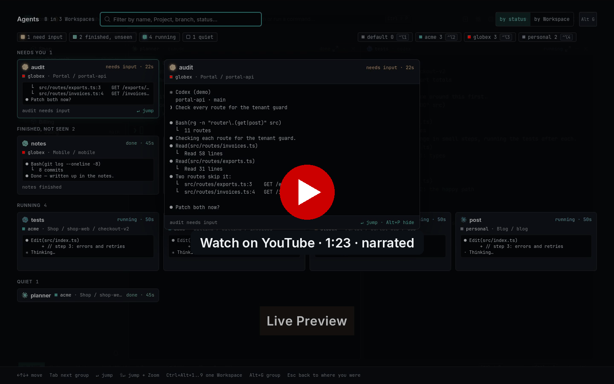
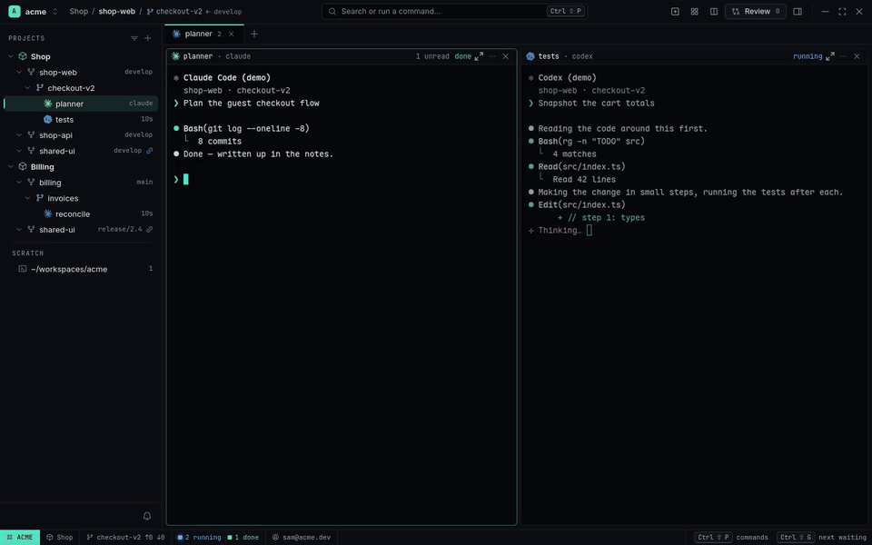
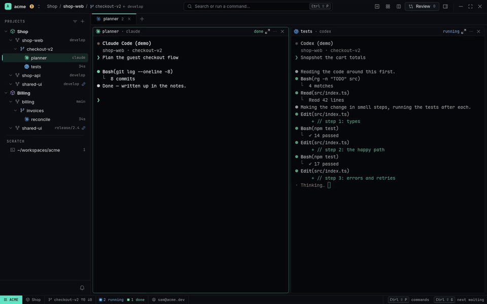
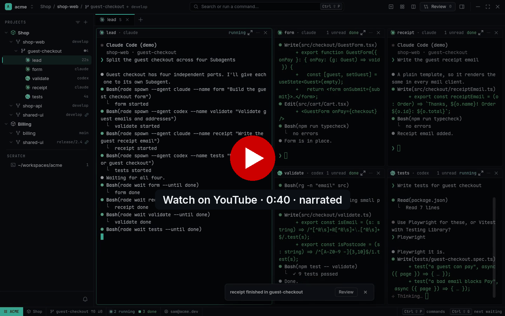
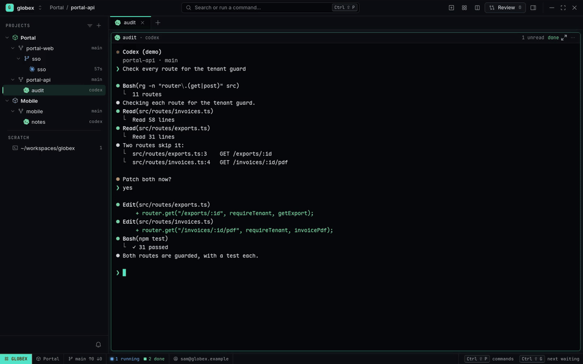
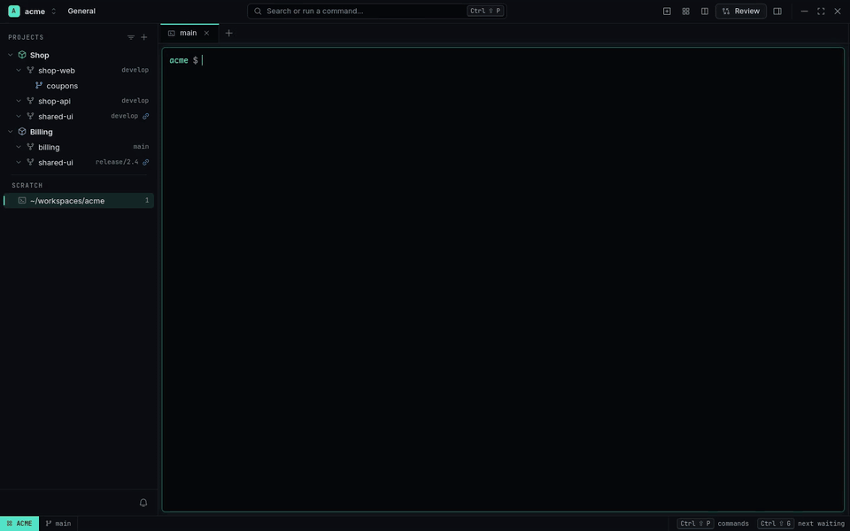
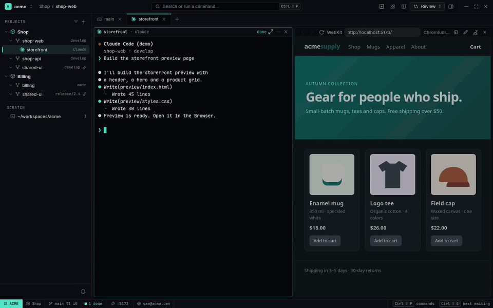
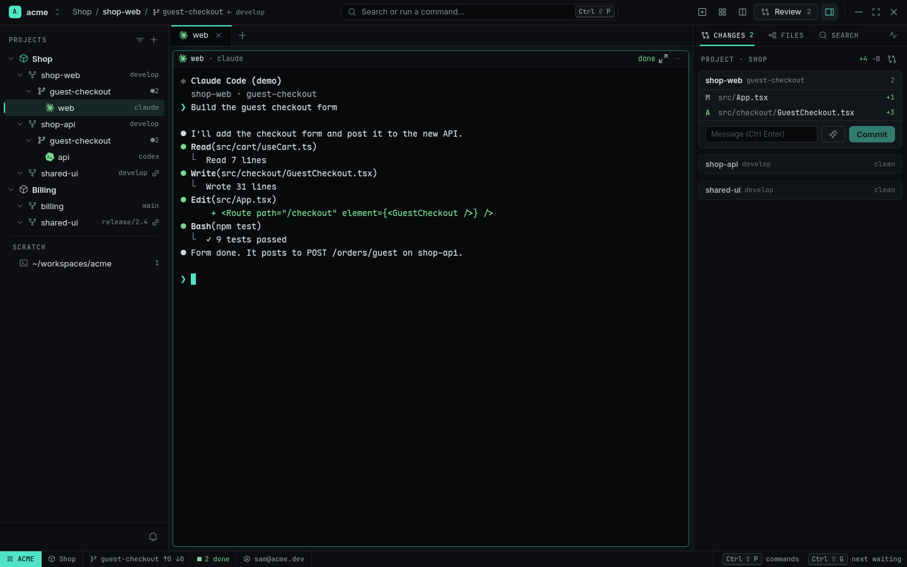
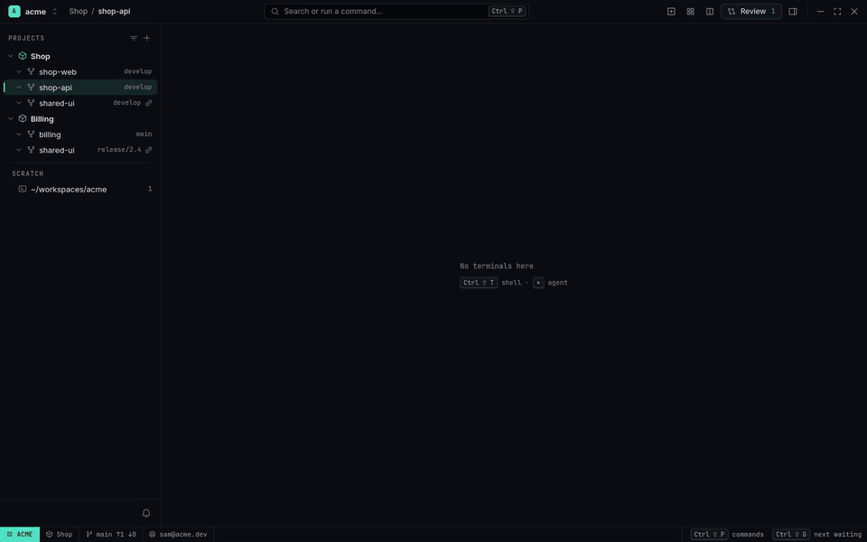

# RADE

[](https://github.com/richard-plg/rade/actions/workflows/ci.yml) [](https://github.com/richard-plg/rade/releases/latest) [](LICENSE)

**An agentic development environment for Linux.** Run Claude Code and Codex agents for every
company and product you work on — many Workspaces, many Projects each — in one native GNOME
window. See at a glance which agent needs you, read its screen without switching, and let one
agent spawn a whole team of others.

[](https://www.youtube.com/watch?v=rpGTswqz1_U)

## Why RADE

- **Many Workspaces, one window** — a Workspace per company, client or side project, each with
  its own git identity, GitHub login and agent accounts; the hidden ones keep running.
- **Many Projects per Workspace** — the repositories one product needs, each at its own base
  branch; a Worktree per task, so agents never trip over each other.
- **Agent Overview with live Previews** — every agent of every Workspace, most urgent first, one
  key away.
- **Agents that drive agents** — any agent can spawn Claude Code or Codex Subagents, wait for them
  and read their answers.
- **Fast and native** — Ghostty's GPU terminal, GTK4 / libadwaita, Wayland. No Electron, no web UI.

## Use cases

### Three Workspaces, one window

Acme (your job), Globex (a client) and your own projects, each with its own Projects — Shop and
Billing, Portal and Mobile, Blog and Dotfiles — and agents at work in all of them. Switch with
`Ctrl+Alt+1…9`. Nothing stops in the Workspace you leave, and when one of its agents asks
something, a Toast names it and the Workspace button turns amber.



→ [Showcase](docs/showcases/three-workspaces-one-window.md) ·
[How to organize Workspaces and Projects](docs/guides/organizing-workspaces-and-projects.md)

### Who needs me? Agent Overview

`Ctrl+Shift+Space` from anywhere, even inside a terminal: every agent of every Workspace, **Needs
you** first. The selected card opens a **live Preview** of its screen, so you can read the
question without going anywhere. `Alt+G` groups by Workspace; `Enter` jumps there and answers.



→ [Agent Overview](docs/features/agent-overview.md)

### One agent, a whole team

Ask Claude Code to *"split the guest checkout across four Subagents"*. It runs `rade spawn` four
times — two Claude Code, two Codex — and they open beside it in its **Agent Grid**, working in
parallel on the same Worktree. When one asks a question it turns amber and waits for you; the
parent waits for each with `rade wait`, reads their answers and sums up.

[](https://www.youtube.com/watch?v=YPz3ZE4oLxo)

→ [Showcase: one agent, a team of agents](docs/showcases/one-agent-a-team-of-agents.md) ·
[the `rade` CLI](docs/features/cli-for-agents.md)

### Read what it touched

`Ctrl+click` any `path:line` an agent prints and the file opens in a Viewer beside it. The
Inspector's **Files** tab shows the Worktree with every changed file marked; Markdown opens
rendered, Mermaid diagrams included.



→ [Viewer, files and search](docs/features/viewer-files-search.md)

### More workflows

| | |
|---|---|
| [](docs/showcases/claude-asks-codex-for-a-review.md)<br>**[Claude asks Codex for a review](docs/showcases/claude-asks-codex-for-a-review.md)** — a second model checks the first; no copy-paste. | [](docs/showcases/fix-ui-with-annotations.md)<br>**[Fix a UI bug by pointing at it](docs/showcases/fix-ui-with-annotations.md)** — the agent gets the selector, a screenshot and the console errors. |
| [](docs/showcases/one-feature-across-repos.md)<br>**[One feature across two repositories](docs/showcases/one-feature-across-repos.md)** — a Worktree and an agent per repository, one Changes page. | [](docs/showcases/two-companies-one-laptop.md)<br>**[Two companies, one laptop](docs/showcases/two-companies-one-laptop.md)** — the right git email, GitHub account and agent login per folder. |
| [](docs/showcases/fan-out-pick-a-winner.md)<br>**[Fan out and pick a winner](docs/showcases/fan-out-pick-a-winner.md)** — three agents, one prompt, a read-only Judge. | [](docs/showcases/review-in-rounds.md)<br>**[Review in rounds](docs/showcases/review-in-rounds.md)** — comment on an agent's diff, send it back, approve. |

All of them: **[Showcases](docs/showcases/README.md)**.

## Features

| | |
|---|---|
| **[Workspaces and identity](docs/features/workspaces-and-identity.md)** — a Workspace per company or client: git email, SSH key, `gh` login and agent accounts; switch in one key | **[Projects and Worktrees](docs/features/projects-and-worktrees.md)** — products spanning repositories, a base branch per link, a Worktree per task |
| **[Agent Overview](docs/features/agent-overview.md)** — `Ctrl+Shift+Space`: every Agent of every Workspace, most urgent first, live Previews, jump with `Enter` | **[Agents](docs/features/agents.md)** — Claude Code, Codex, Antigravity, OpenCode or any CLI; the Agent Grid of Subagents; status from hooks; Session Restore |
| **[Viewer, files and search](docs/features/viewer-files-search.md)** — Files tree, code, Markdown with Mermaid, HTML, PDF; project search; command palette | **[Terminals and layout](docs/features/terminals-and-layout.md)** — Tabs, splits, Ctrl+click `file:line`, image paste as a path, IME |
| **[The `rade` CLI for agents](docs/features/cli-for-agents.md)** — spawn, wait for, read and drive other agents, the browser and the code index | **[Agent Accounts and usage](docs/features/accounts-and-usage.md)** — several logins per agent, limits, forecasts, switch before you run out |
| **[Browser and Annotations](docs/features/browser.md)** — your dev server beside the agent; click what's wrong, send it as a prompt | **[Code navigation](docs/features/code-navigation.md)** — definition, references, callers, hover and Impact through real language servers |
| **[Changes and PRs](docs/features/changes-and-prs.md)** — stage hunks, commit, push and open PRs; agents draft, you confirm | **[Fan-out](docs/features/fan-out.md)** — one prompt to several agents, a read-only Judge, keep the Winner |
| **[Review](docs/features/review.md)** — an Agent's diff against its base, inline comments sent back as a prompt | **[Settings and config](docs/features/settings-and-config.md)** — Settings page, layered config per Workspace, Project and repository |


## Install

Ubuntu 26.04, GNOME on Wayland, amd64. Download the `.deb` from the
[latest release](https://github.com/richard-plg/rade/releases/latest), then:

```sh
sudo apt install ./rade_*_amd64.deb
rade setup            # teach your agents to report their status (shows a diff, keeps backups)
```

Open **RADE** from the app launcher. Then follow **[Getting started](docs/getting-started.md)** —
ten minutes from install to two Workspaces, their Projects and a team of Agents. Building from
source: [CONTRIBUTING.md](CONTRIBUTING.md).

## A taste of the CLI

```sh
rade workspace switch globex
rade spawn --agent claude --worktree new "Add coupon codes to the cart"
rade spawn --agent codex --name tests "Write tests for guest checkout"   # from an agent: a Subagent
rade wait tests --until done && rade read tests --lines 100
rade fanout --agents claude,codex,claude "Speed up the product grid"
rade browser open 5173 && rade browser snapshot
rade code callers src/money.ts:1:17
```

Full reference: [The `rade` CLI](docs/features/cli-for-agents.md) · [API](docs/API.md).

## Documentation

**[docs/](docs/README.md)** — getting started, the [Workspaces and Projects guide](docs/guides/organizing-workspaces-and-projects.md),
every feature, showcases, [keybindings](docs/keybindings.md).

## Status

RADE 1.0 is stable: the `rade` CLI, the socket API and the config and state files only change
incompatibly in a new major version ([docs/RELEASING.md](docs/RELEASING.md)). Linux only — Wayland,
GNOME, Ubuntu 26.04 are what it's built and tested on. Not planned: Flatpak/Snap (a sandbox can't
run arbitrary agent CLIs), X11, macOS, Windows.

## Contributing

Bug reports and pull requests are welcome: see [CONTRIBUTING.md](CONTRIBUTING.md). Security issues:
[SECURITY.md](SECURITY.md).

## License

[MIT](LICENSE). Embeds [Ghostty](https://ghostty.org) (MIT) and code from
[limux](https://github.com/am-will/limux) (MIT); bundled fonts and icons under their own licenses —
see [THIRD_PARTY.md](THIRD_PARTY.md).
