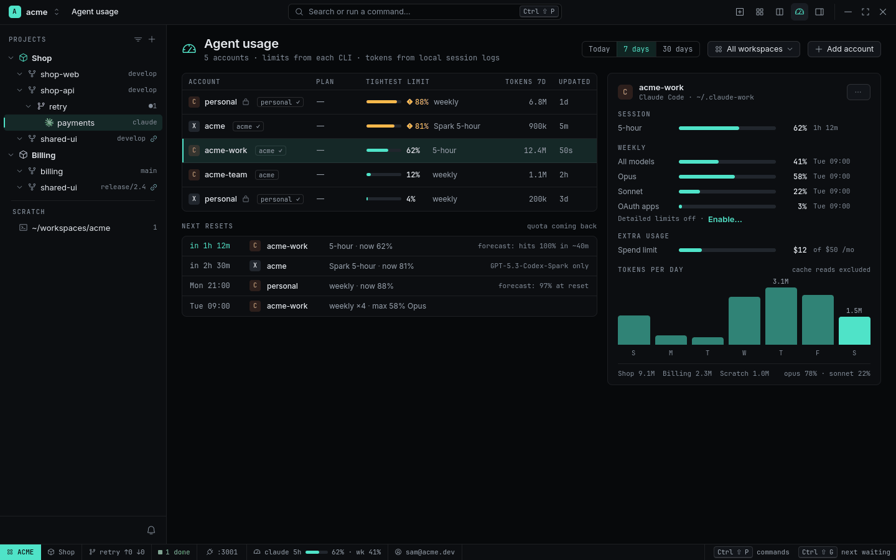
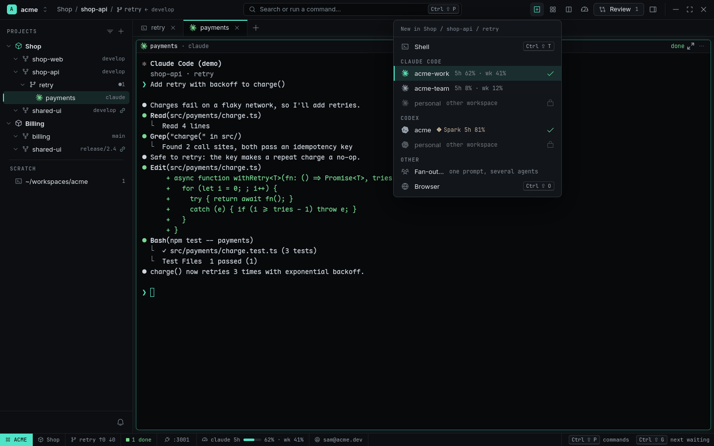
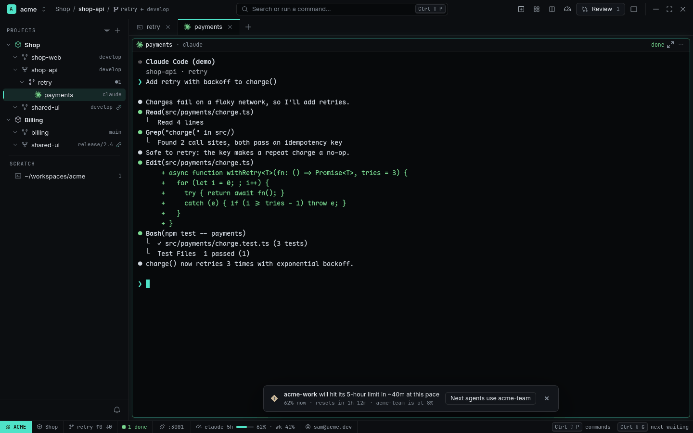

# Agent Accounts and usage

Most people who use agents a lot have more than one login: a company Claude seat, a team seat, a
personal subscription, a Codex plan. RADE lets each Workspace declare its **Agent Accounts**,
runs every Agent under exactly one, and shows how close each login is to its limits — before you
hit them.

<picture>
  <source media="(prefers-color-scheme: light)" srcset="../images/usage-light.png">
  
</picture>

## Declare accounts

An account is an agent (`claude` or `codex`), a name and the config dir that holds its login
(`CLAUDE_CONFIG_DIR` / `CODEX_HOME`). Declare them in the Workspace's `workspace.toml`:

```sh
rade account add --workspace acme --agent claude --name acme-work --config-dir ~/.claude-acme --default
rade account add --workspace acme --agent claude --name acme-team --config-dir ~/.claude-acme-team
rade account add --workspace acme --agent codex  --name acme      --config-dir ~/.codex-acme
rade account list
rade account default acme-team --agent claude
```

Then log in once per config dir the agent's own way (e.g. run `CLAUDE_CONFIG_DIR=~/.claude-acme
claude` and `/login`), and run `rade setup` so each dir gets RADE's hooks.

## Start an Agent under an account

The titlebar **`+`** menu lists the accounts of the Workspace on screen, grouped by agent, with
the default ticked and each one's current limit. Accounts of other Workspaces are shown dimmed
with a lock: they can't be used here.

<picture>
  <source media="(prefers-color-scheme: light)" srcset="../images/new-menu-light.png">
  
</picture>

```sh
rade spawn --agent claude --account acme-team "Review the payment retries"
```

Without `--account`, a Subagent uses its parent's account, anything else the Workspace default.
The Pane gets that account's config dir and `RADE_ACCOUNT`. RADE refuses (exit 7) an account from
another Workspace, or an agent command whose `CLAUDE_CONFIG_DIR=` / `CODEX_HOME=` prefix points at
a different login — a company Agent can't quietly run on your personal seat, or the other way round.

## Usage and limits

RADE reads limits and tokens from what the agent CLIs already write — nothing is sent anywhere:

- **Claude Code**: `rade setup` wraps the statusline command (keeping yours, run after it) so
  RADE receives the 5-hour, weekly and spend limits Claude Code reports.
- **Codex**: RADE reads the rate limits and token counts in its session logs.
- **Tokens** for both come from the local session logs, by day, Project and model (cache reads
  excluded).

The **Usage page** — from the Statusline's usage cell, the titlebar gauge or `> usage` in the
palette — shows every account sorted by its **tightest limit** (the one closest to 100 %),
**Next resets** with forecasts (`hits 100% in ~40m`, `97% at reset`), and the selected account's
limits and tokens per day, per Project and per model. Filter by period and Workspace.

The **Statusline** shows the focused Agent's account: `claude 5h ▰▰▱ 62% · wk 41%`.

## Before you hit a limit

When a limit is forecast to reach 100 % before it resets, a Toast offers to switch:

<picture>
  <source media="(prefers-color-scheme: light)" srcset="../images/forecast-light.png">
  
</picture>

**Next agents use acme-team** changes only the default for Agents you start afterwards; running
ones keep their login. Activity logs each account passing 80 %, getting blocked and resetting.

```sh
rade account usage               # every account, one line each
rade account usage acme-work --json
```

## Detailed limits (opt-in)

Claude's per-model weekly limits (Opus / Sonnet) aren't in the statusline. With
`detailed_limits = true` on a Claude account, RADE asks Claude's usage endpoint for them at most
once every 5 minutes. The login token is read from the account's config dir only for that call,
passed to `curl` on stdin and never stored or logged. Any unexpected answer turns the option off
and says so in Activity.

## Related

- [Workspaces and identity](workspaces-and-identity.md)
- [Showcase: two companies, one laptop](../showcases/two-companies-one-laptop.md)
