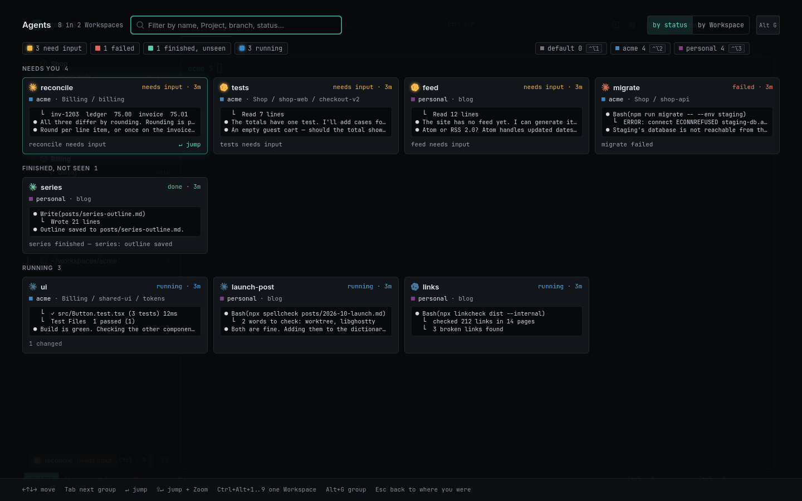
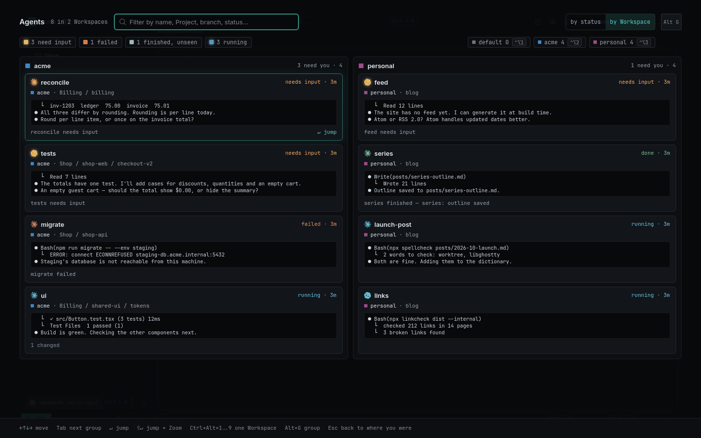

# Agent Overview

With a dozen Agents across two companies, the question is always *who needs me right now?*
`Ctrl+Shift+Space` answers it from anywhere — even from inside a terminal — with every Agent of
every Workspace on one screen, most urgent first.

<picture>
  <source media="(prefers-color-scheme: light)" srcset="../images/overview-light.png">
  
</picture>

[Watch as MP4](../images/overview.mp4)

## What you see

Cards in four bands:

1. **Needs you** — waiting, then failed, then interrupted; newest first.
2. **Finished, not seen** — done, with a Notification you haven't read.
3. **Running** — newest status change first; `quiet 12m` once its screen hasn't changed for
   10 minutes.
4. **Quiet** — done and read, or exited; one line each.

Each card shows the agent's glyph in its status colour, its name and model, the status and its age
(`needs input · 4m`), the Workspace and `Project / link / Worktree`, the last three lines of its
screen, its last Notification, the branch's `↑ahead · n changed`, and the Agent Account it runs
under. The Agents of one [Fan-out](fan-out.md) share one card.

Rest the pointer (or the selection) on a card for a **Preview**: up to 24 live lines of that
Agent's screen, so you can read what it's asking without leaving the Overview. `Alt+P` turns
keyboard previews off and on.

## Keys

| Key | Action |
|---|---|
| `Ctrl+Shift+Space` | Open (also the titlebar button, the palette, the switcher's `!`, a Statusline count) |
| type | Filter: every word must match a name, model, Workspace, Project, branch, status or notification text |
| arrows | Move through the grid |
| `Tab` / `Shift+Tab` | Next / previous band |
| `Enter` | Jump to the Agent — switches Workspace if needed and marks its Notifications read |
| `Shift+Enter` | Jump and Zoom its Pane |
| `Alt+R` | Open the Review of the selected Agent's Worktree |
| `Ctrl+Alt+1…9` | Show only one Workspace (again: all) |
| `Alt+G` | Group by status ⇄ by Workspace |
| `Esc` | Clear the filter, else close and go back where you were |

**Hold to flip:** keep `Ctrl+Shift` down and press `Space` again to step to the next card;
release `Ctrl` to jump to it — like `Alt+Tab` for Agents.

<picture>
  <source media="(prefers-color-scheme: light)" srcset="../images/overview-by-workspace-light.png">
  
</picture>

## Notes

- It reads each card's screen once a second and only while open; closing it costs nothing.
- With GNOME's *Reduce animation* setting, nothing moves.
- From the CLI, `rade list --all` lists every Workspace's Panes and statuses.

## Related

- [Agents](agents.md) — statuses, Notifications, Inbox.
- [Workspaces and identity](workspaces-and-identity.md) — why there are several Workspaces.
