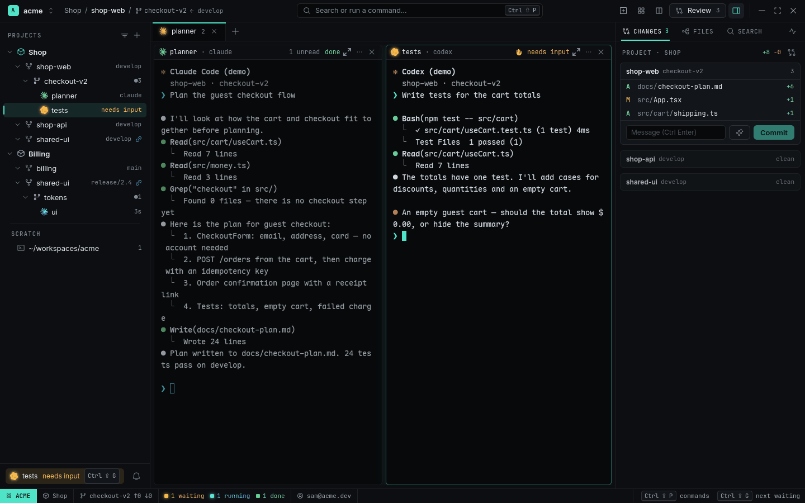

# Agents

RADE runs coding-agent CLIs — Claude Code, Codex, Antigravity, OpenCode, or any command you
configure — in GPU terminals, and keeps track of each one: is it working, finished, or waiting for
you?

<picture>
  <source media="(prefers-color-scheme: light)" srcset="../images/workspace-light.png">
  
</picture>

## Start an Agent

- The **`+`** button in the titlebar or tab strip: Shell, then each agent's accounts (default
  ticked), Fan-out… and Browser.
- The command palette (`Ctrl+Shift+P`): *Spawn Agent…* (agent, prompt, New Tab / Split Right /
  New Worktree) or *Spawn claude*, *Spawn codex*…
- From any terminal, including another Agent:

  ```sh
  rade spawn --agent claude "Fix the flaky checkout test"
  rade spawn --agent codex --worktree new --name coupons "Add coupon codes to the cart"
  rade spawn --cmd "npm run dev" --split down          # any program, no agent
  ```

An Agent started from another Agent is its **Subagent**: it opens in the parent's Tab, parent on
the left, up to 8 children tiled on the right (the **Agent Grid**). Limits keep a runaway agent in
check: at most 8 live Subagents per parent and a depth of 3 (both configurable under `[limits]`).

You can also start an agent by hand in any terminal (`claude`, `codex`…). RADE recognizes it from
the running process and shows its glyph; its status comes from its hooks.

## Status at a glance

Every Agent has a status, drawn as its own logo in the status colour — in the Navigator, on its
Tab, in its Pane header, in the Inbox and in Agent Overview:

| Status | Looks like | Meaning |
|---|---|---|
| running | blue, pulsing | working on a turn |
| waiting | amber with a glow, `needs input` | asking you something or waiting for permission |
| done | green | the turn finished |
| error | red | it failed |
| interrupted | violet | RADE quit mid-turn; it was resumed idle and needs a prompt to go on |
| exited | grey | the program ended |

Status comes from the agents' own **hooks**, which `rade setup` installs (see below). For agents
without hooks RADE falls back to conservative guesses — a bell or notification while running
means *waiting*, a screen that stops changing means *done* — and says so in the tooltip.

The Statusline counts Agents per status for the shown Workspace (`1 waiting · 2 running · 3 done`);
click a count to open Agent Overview filtered to it.

## Notifications, Inbox and Toasts

When an Agent starts waiting, finishes or fails, RADE raises a **Notification** on that exact
Pane. So do terminal notification sequences (OSC 9 / 777), the bell, and `rade notify`.

- The **Inbox** pill at the foot of the Navigator (`tests needs input`) and the bell open the list,
  newest first. Click a row to jump to its Pane. `Ctrl+Shift+G` jumps to the newest unread one
  from anywhere.
- A **Toast** at the bottom of the window appears only when the waiting Agent is not on screen:
  `tests needs input · Show`.
- A **desktop notification** is sent when the RADE window is not active or the Pane is hidden
  (`desktop_notify = "smart"`, the default; or `"always"`, `"off"`). It has a Focus button.

Focusing a Pane marks its Notifications read.

## Session Restore

Quit RADE (or let it crash) and start it again: Workspaces, Projects, Worktrees, Tabs, splits,
working directories and Agents come back. Each Agent is resumed in its own session (Claude Code
with the session id RADE gave it, the others with the id their hooks reported), with the exact
command line it was started with. Processes themselves don't survive a restart; an Agent that was
mid-turn comes back **interrupted** — send it "continue".

## Install the hooks

```sh
rade setup --dry-run   # show what would change
rade setup             # Claude Code, Codex, Antigravity, OpenCode found on PATH
```

`rade setup` merges RADE's hooks into each agent's config (every Claude config dir, each
Workspace's Agent Account dirs), shows a diff, keeps a backup of every file it changes and can be
run again safely. It also installs the `rade` skills for Claude Code. The hooks call `rade` from
your `PATH` and do nothing outside a RADE Pane.

- **Codex** runs hooks only after you trust them once: run `/hooks` inside Codex and trust the
  RADE entries. RADE reminds you once.
- **Codex, OpenCode, Antigravity**: add [AGENTS-snippet.md](../AGENTS-snippet.md) to your
  `AGENTS.md` so they know how to drive other agents.

## Agent Presets

A Preset says how to start, resume and observe one kind of agent. The built-in ones are `claude`,
`codex`, `agy` (Antigravity) and `opencode`. Change or add them in `config.toml`:

```toml
[agents.claude]
command = "claude --dangerously-skip-permissions"

[agents.reviewer]            # a Preset of your own
command = "codex --model gpt-5.3-codex"
icon = "~/icons/reviewer.svg" # optional: your own icon instead of the glyph
```

A command (or a model) that differs per company or product can go in the Workspace's or Project's
file instead — see [Settings and config](settings-and-config.md). Which *login* an agent runs
under is an [Agent Account](accounts-and-usage.md).

## Typing to agents

- `Shift+Enter` inserts a newline in Claude Code, Codex, Antigravity and OpenCode (RADE never
  captures it).
- `Ctrl+Shift+V` with an image on the clipboard saves it as a PNG and pastes its path — agents
  read images from paths. Dropping image files on a terminal pastes their paths. `Ctrl+V` goes to
  the program untouched.
- Input methods (IBus, Fcitx5) work, with preedit at the cursor.

## Related

- [Agent Overview](agent-overview.md) — every Agent of every Workspace in one view.
- [CLI for agents](cli-for-agents.md) — how agents spawn, wait for and read each other.
- [Review](review.md) — read what an Agent changed and send it comments.
