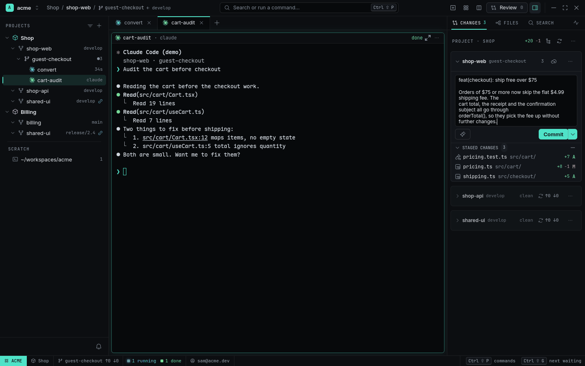
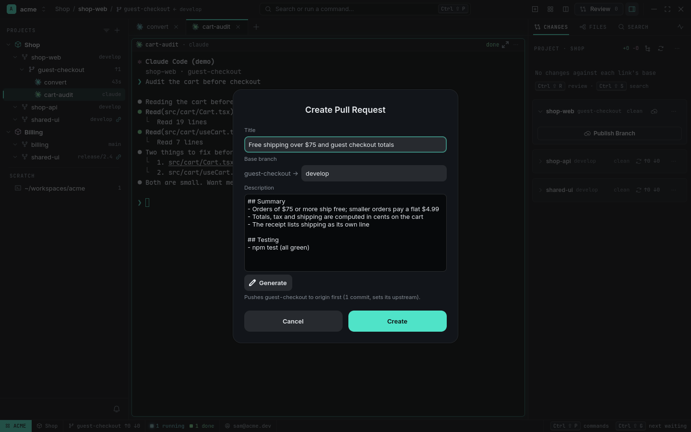

# Changes and pull requests

The Inspector's **Changes** tab is a git panel in the shape of VS Code's Source Control: one
**card** per Source link of the focused Project (a checkout in no Project gets one card for
itself), each with its commit box, its staged and unstaged files, Sync / Publish and PR. RADE runs
git or `gh` only when you click — agents can draft the message, but you confirm. The one
exception is auto-fetch, which is off until you turn it on.

<picture>
  <source media="(prefers-color-scheme: light)" srcset="../images/changes-commit-light.png">
  
</picture>

## Cards and files

`Ctrl+Shift+M` opens Changes (`Ctrl+Shift+E` toggles the Inspector). The header reads
`PROJECT · SHOP` or `SOURCE · SHOP-API`; its buttons switch the list between **list** and **tree**
view, refresh, and open a menu with **Fetch All** and the sort order.

A card's header shows the link, its Worktree or branch, a count, the `↑ahead ↓behind` button
(**Sync**) or a **Publish** button, and a `…` menu: Fetch, Pull, Push…, Sync…, Publish Branch…,
Create Pull Request…, Stage All Changes, Unstage All Changes, Discard All Changes…. Below the
commit box come the groups, each with its count and bulk buttons:

- **Merge Changes** — conflicted files (`!`).
- **Staged Changes** — what the next commit holds.
- **Changes** — modified files and untracked files (`U`).

A clean card folds to its header, unless it has a Publish or Sync button to show. A link whose
checkout does not exist yet (a Project checkout nobody created) folds too and says "No checkout yet"
in muted text; it counts as clean, and no error is shown for it.

Hover, select or focus a row and its counts give way to buttons: Open File, Stage Changes, Discard
Changes (Delete File for an untracked one), Unstage Changes, or Mark as Resolved for a conflict.

| Do | Result |
|---|---|
| Click a row | Select it and open its diff in a [Diff Pane](#the-diff-pane); the keyboard stays in the list |
| Double-click | Open the diff and move to it (a conflicted file opens in a Viewer: it has no diff) |
| `Ctrl+click` / `Shift+click` | Add to / extend the selection |
| `Space` | Stage (or unstage) the selected files |
| `Delete` | Discard the selected files — it asks once |
| Right-click | Open Changes, Open File, Open File to the Side, Stage / Unstage, Discard or Delete, Add to .gitignore, Copy Path |

**Discard** restores a tracked file's unstaged changes (staged ones stay). An untracked file goes to
the **trash**; if the trash fails, a second dialog offers to delete it permanently. **Add to
.gitignore** appends `/<path>` to the repository's `.gitignore`.

Tree view folds folders (a folder with one child folder reads `src/ui/`); list view sorts by path,
name or status. Both choices are kept in `config.toml`.

## Commit

Type a message (1–10 lines; `Up` on its first line and `Down` on its last walk through the last 20
commit messages) and **Commit** (`Ctrl+Enter`). A first line over 72 characters shows a warning.
With a message, nothing staged and changes present, Commit asks `Stage all N changes and commit?`.

**Commit ▾** adds **Commit (Amend)** (an empty box keeps the last message), **Commit & Push**,
**Commit All** (stages everything, untracked files too) and **Undo Last Commit** (keeps the
changes staged and puts the message back in the box). RADE never force-pushes, so Amend and Undo
are off once `HEAD` is on a remote branch.

**Generate** (the sparkle button) asks an agent for a draft message from the staged diff, the
repository's `CLAUDE.md` / `AGENTS.md` / `CONTRIBUTING.md` and recent subjects. It only fills the
box. When the checkout's `git config user.email` differs from the Workspace's identity, the
Statusline cell turns amber and the commit area warns you.

## Publish, sync, fetch, push, PR

A branch without its own upstream shows **Publish Branch**; one with an upstream shows
`↑ahead ↓behind` and, when it is clean and has something to pull or push, **Sync Changes**. Sync
asks once, pulls with `--ff-only`, then pushes; if the pull fails, nothing is pushed and the card
shows git's message. **Push** and **Publish** always ask first, naming the remote, branch and
commit count.

**Fetch** (card `…` menu, or **Fetch All**) runs `git fetch` and never changes a branch. Set
`autofetch = true` and RADE fetches every card on its own every few minutes — the only git network
call it makes without a click. **Pull** is `--ff-only`.

**Create PR…** opens a dialog with title, body and base — by default the Worktree's base, the
same base its Review used. Generate fills the title and body from the branch's diff and commits
(and your PR template). Creating pushes the branch first if needed, then runs `gh pr create`
under the Workspace's `gh` login; the PR link shows in a Toast.

<picture>
  <source media="(prefers-color-scheme: light)" srcset="../images/pr-dialog-light.png">
  
</picture>

## The Diff Pane

A click on a Changes row opens a **Diff Pane** in the Tab: the Tab's own Diff Pane navigates to the
file, else a new one opens right of the focused Pane. Its title says which side it shows —
`app.rs (Working Tree)` (the file against the index), `(Staged)` (the index against `HEAD`) or
`(Untracked)`. The header has Previous / Next Change (`Shift+F7` / `F7`, wrapping), a layout
toggle, **Show Full File**, Stage / Unstage File, Discard File, Open File and Close (`Esc`).

The layout is **inline** or **side by side**; the default `auto` goes side by side from 900 px
wide. On a modified text file each hunk has **Stage Hunk** / **Unstage Hunk** / **Discard
Hunk…**, and selected lines can be staged, unstaged or discarded. Discarding asks first. The pane
refreshes every 2 seconds and after its own actions; when the file no longer has changes on that
side it says **No changes** and offers a button for the other side. A Diff Pane survives a
restart.

## Quick Diff

A Viewer of a tracked file marks the lines that differ from the index in its gutter: an added
line, a modified line, or a triangle where lines were deleted. Click a mark for a peek of that
change with **Stage Change**, **Revert Change…** (asks) and **Open Changes**. The peek shows git's
hunk, so it may cover a few nearby marks.

## Base drift card

When a link's checkout is on another branch than its base, Changes shows a card with what to do:
**Back to base**, **Keep, show in Shop** or **Move to a Worktree…**. See
[Base drift](projects-and-worktrees.md#base-drift).

## Settings

```toml
[scm]
draft_command = 'claude -p --tools "" --no-session-persistence'   # the default; any command that reads a prompt on stdin
view = "list"             # "list" | "tree"
sort = "path"             # "path" | "name" | "status" (list view)
autofetch = false         # fetch every card in the background; never pulls or pushes
autofetch_period = 180    # seconds, 60 to 3600
diff_layout = "auto"      # "auto" | "inline" | "side_by_side"
quick_diff = true         # gutter marks in the Viewer
```

Set `draft_command` per Workspace or Project to use another agent or model for drafts. The view,
sort and the other keys are also rows of **Settings → Source Control**.

## Related

- [Review](review.md) — *Approve ▾ → Commit myself…* and *Create PR…* open these.
- [Keybindings](../keybindings.md#changes-the-inspectors-list)
