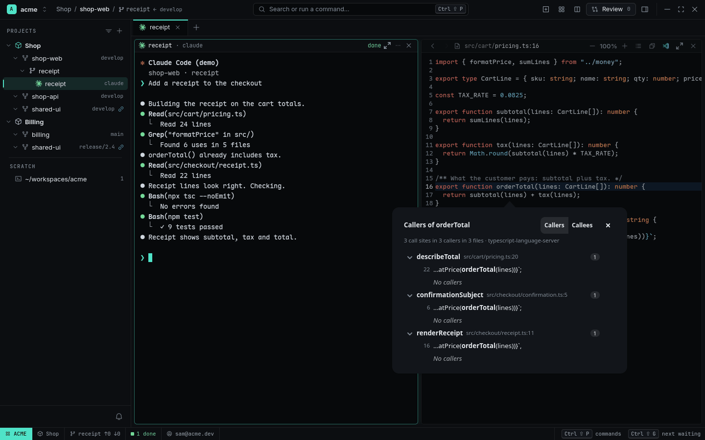
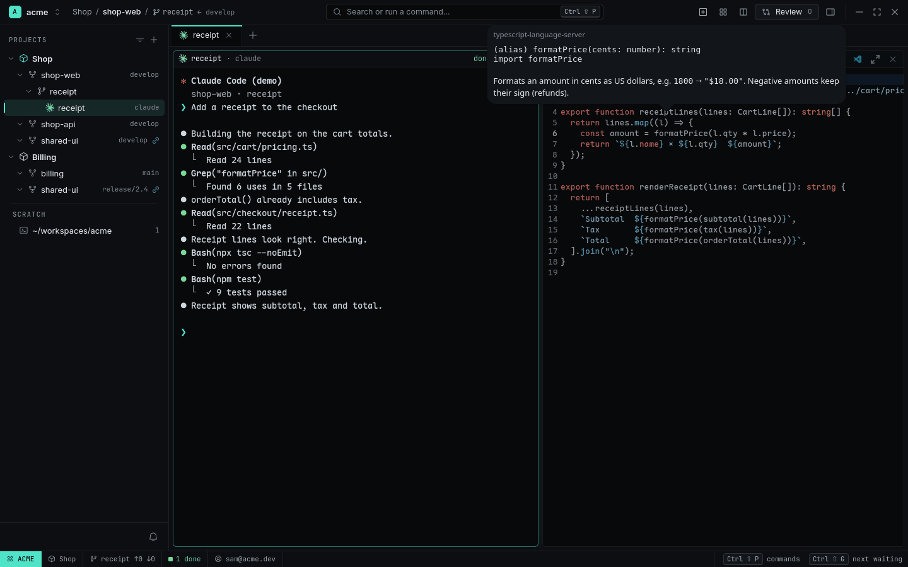
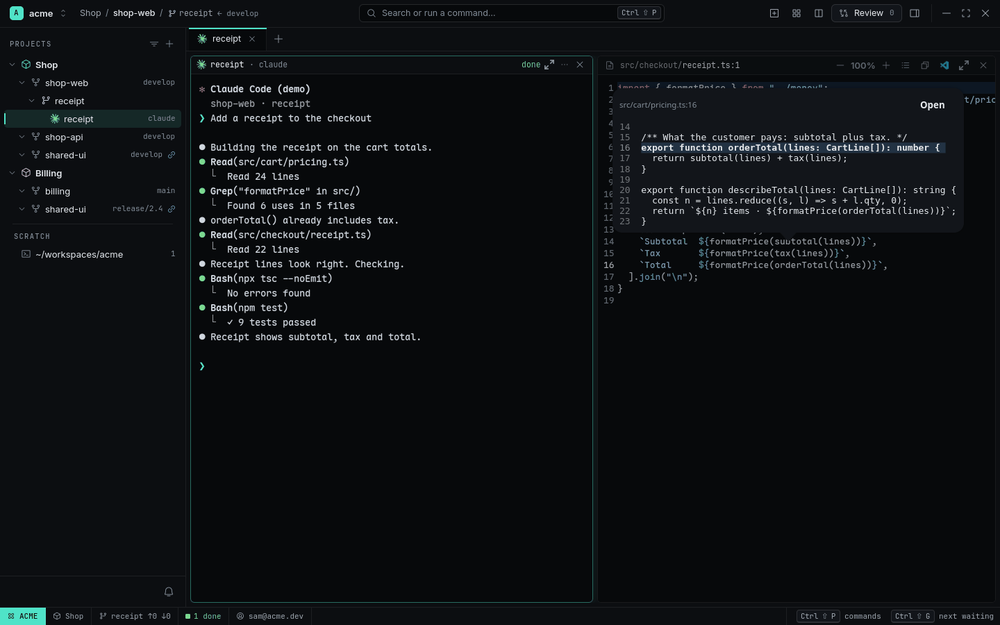

# Code navigation

Go to definition, find references, see who calls a function — in the Viewer, in the Review's diff,
and for Agents from the command line. RADE runs real language servers (rust-analyzer,
typescript-language-server, pyright, gopls), one per project root, shared by you and every Agent.

<picture>
  <source media="(prefers-color-scheme: light)" srcset="../images/callers-light.png">
  
</picture>

## In the Viewer and the Review

| Key | Action |
|---|---|
| `F12` or `Ctrl+click` | Go to definition |
| `Shift+F12` | References |
| `Alt+Shift+H` | Callers (call hierarchy; switch to Callees in the popover) |
| `Ctrl+F12` | Implementations |
| `Ctrl+I`, or hold `Ctrl` over a name | Hover: signature, type and docs |
| `Alt+F12` | Peek the definition in place, with Open |
| `Alt+Shift+O` | Outline of the file |
| `Alt+Left` / `Alt+Right` | Back / Forward |
| `$` in the palette | Search the Worktree's symbols |

Holding `Ctrl` underlines names like links. A single result jumps there; several open a results
popover grouped by file. In the [Review](review.md) the same keys work on diff lines — for a
**removed** line RADE looks the name up in the current tree, or at the base commit.

<picture>
  <source media="(prefers-color-scheme: light)" srcset="../images/hover-light.png">
  
</picture>

<picture>
  <source media="(prefers-color-scheme: light)" srcset="../images/peek-light.png">
  
</picture>

## Impact

**Impact** lists every function, method or type a Worktree's diff changes, adds or removes, with
its callers *outside* the diff — call sites from the language server plus text matches in tests,
and for removed symbols the places still using them. It shows as a rail in the Review (`i`), goes
into the Fan-out Judge's prompt, and agents get it with `rade code impact`.

## For Agents

```sh
rade code def src/cart/useCart.ts:9:17        # where it's defined
rade code refs src/cart/useCart.ts:9:17       # every use
rade code callers src/money.ts:1:17 --depth 2 # who calls it, and who calls those
rade code callees src/cart/Cart.tsx:5:17
rade code hover src/money.ts:1:17
rade code symbols src/cart/useCart.ts         # outline; --query <text> for the Worktree
rade code impact                              # this Worktree's diff against its base
rade code status                              # running servers
```

Output is `path:line:col<TAB>name<TAB>line`, relative to the Worktree; `--json` for the full
answer. The `rade` skill tells agents to run `rade code callers` before changing a function's
signature.

## Servers

| Language | Server | Install |
|---|---|---|
| Rust | `rust-analyzer` | `rustup component add rust-analyzer` |
| TypeScript / JavaScript | `typescript-language-server` (from `node_modules/.bin` first) | `npm i -g typescript-language-server typescript` |
| Python | `pyright-langserver`, else `basedpyright-langserver` | `npm i -g pyright` or `pipx install basedpyright` |
| Go | `gopls` | `go install golang.org/x/tools/gopls@latest` |

RADE never installs one; a missing server is named with its install command. A server starts on
the first request for its root (never at app start), stops after 15 idle minutes, and at most 4
run at once (least recently used first). While a server is indexing, missing or slow, answers come
from text search and are labelled **text matches**.

```toml
[code]               # these two only in ~/.config/rade/config.toml
idle_minutes = 15
max_servers = 4      # each can use about 2 GB

[code.server.rust]
settings = { "rust-analyzer" = { cargo = { features = "all" } } }

[sources.huge-monorepo]
code = false          # no language servers for this repository
```

`[code.server.*]` can also be set per Workspace or Project, or in a repository's `.rade.toml`
(which counts only after `rade config trust`).

## Related

- [Viewer, files and search](viewer-files-search.md)
