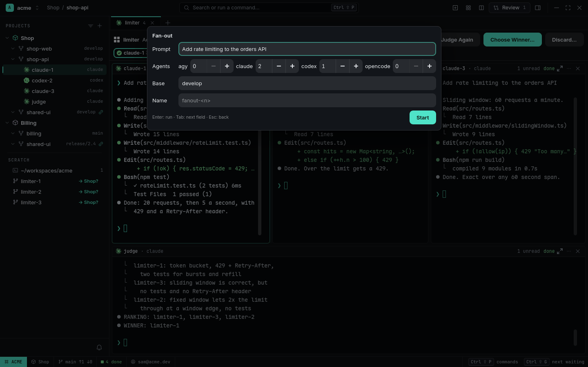

# Fan-out

Not sure which approach — or which agent — will do best? Send **one prompt to several Agents** at
once. Each works in its own Worktree from the same commit, you watch them side by side, a
read-only **Judge** compares the results, and you pick the **Winner**.

<picture>
  <source media="(prefers-color-scheme: light)" srcset="../images/fanout-light.png">
  
</picture>

## Start one

From the command palette: **Fan-out…** — the prompt, how many of each agent, the base and a
name. Or from a terminal:

```sh
rade fanout --source shop-api --agents claude,codex,claude --name limiter "Add rate limiting to the orders API"
```

<picture>
  <source media="(prefers-color-scheme: light)" srcset="../images/fanout-form-light.png">
  
</picture>

Agents can repeat (`claude,claude,codex`): the same agent twice gives you two different attempts.
RADE checks every agent is installed and within your limits before it creates anything, then makes
one Worktree per Agent (`limiter-1`, `limiter-2`, …) — each runs the Source's setup command — and
opens one **Fan-out Tab** with all of them.

The **Fan-out bar** above them shows the prompt, progress (`2/3 done`), and a chip per Agent
with its status and `+/−` against the base. **Diff** on a chip opens that Worktree's
[Review](review.md).

## Judge

When every Agent has finished, **Judge** starts a Judge Agent (Claude Code unless you set
`[fanout] judge`). It runs read-only whatever its permissions — Claude Code gets only its Read,
Grep and Glob tools, Codex a read-only sandbox — and sees the task and every diff under neutral
names in random order, plus each candidate's [Impact](code-navigation.md#impact): which callers
each change can break. It ends with a ranking and `WINNER: <name>`, which RADE pre-selects. You
still decide.

<picture>
  <source media="(prefers-color-scheme: light)" srcset="../images/fanout-verdict-light.png">
  
</picture>

## Choose a Winner

**Choose Winner…** (default: the Judge's pick):

- **Squash** — the Winner's whole result (its commits, edits and new files) is staged on the
  Source's current branch with `git merge --squash`. **RADE never commits**: you (or an Agent)
  review the staged change and commit it. Refused on a detached HEAD, a merge in progress or
  uncommitted changes; conflicts are left for you.
- **Keep** — leave the Winner's Worktree and branch as they are, and keep working there.

Then RADE offers to remove the other Worktrees and branches. **Discard…** removes them all.

```sh
rade fanout status limiter
rade fanout judge limiter
rade fanout choose limiter --strategy squash --cleanup
rade fanout discard limiter
```

## Notes

- A Fan-out survives a restart: its Worktrees, Tab, each Agent's progress, the verdict and the
  Winner. An Agent cut off mid-turn shows `interrupted`; **Continue** on the bar resumes those.
- Closing one of its Agents asks first; `rade close` refuses until a Winner is chosen (or use
  `--force`).
- 2 to 8 Agents (`limits.max_children`).

## Related

- [Showcase: fan out and pick a winner](../showcases/fan-out-pick-a-winner.md)
