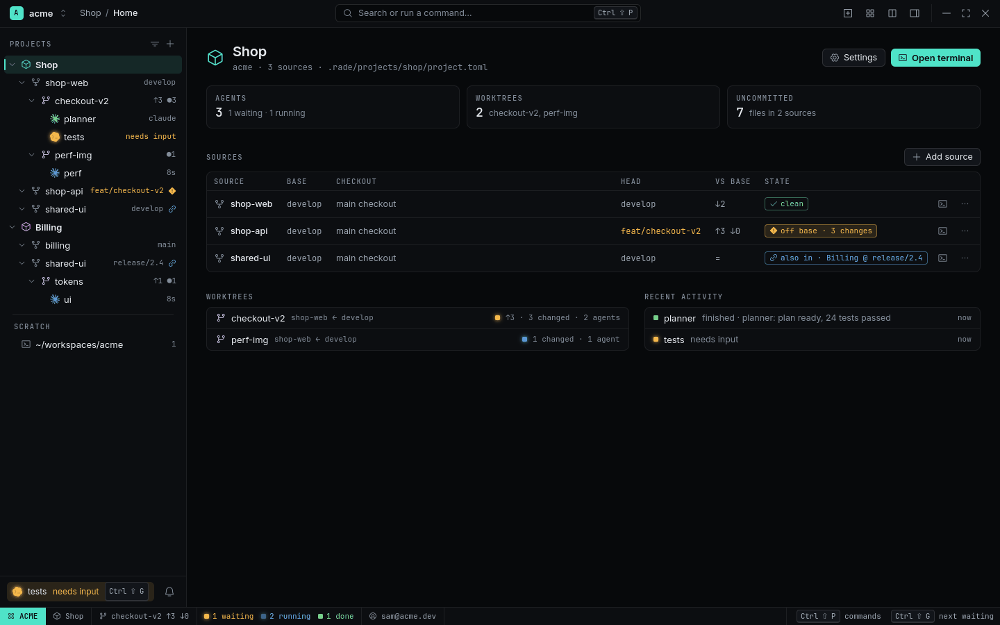
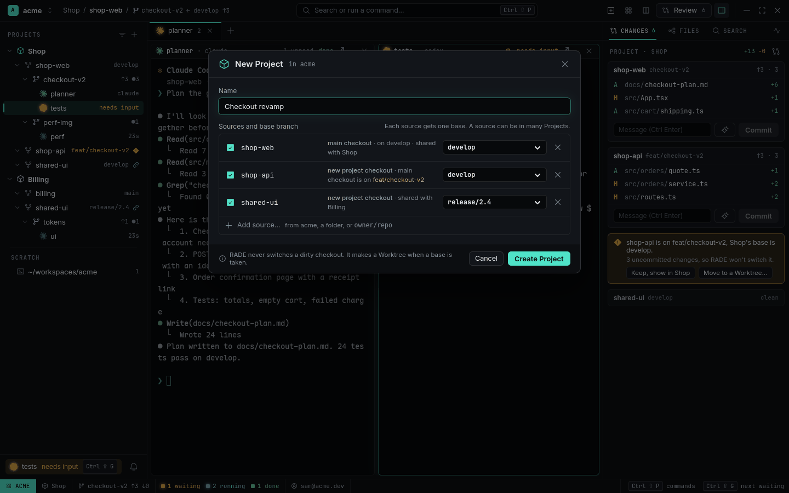
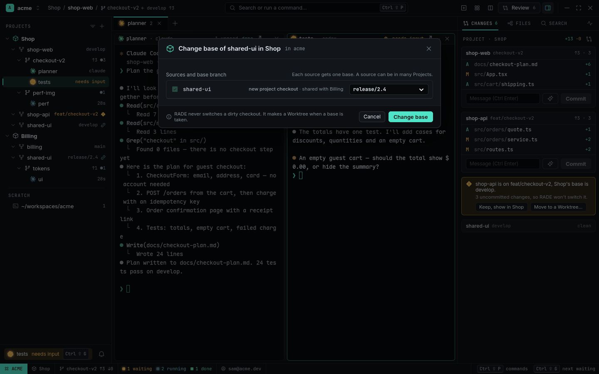
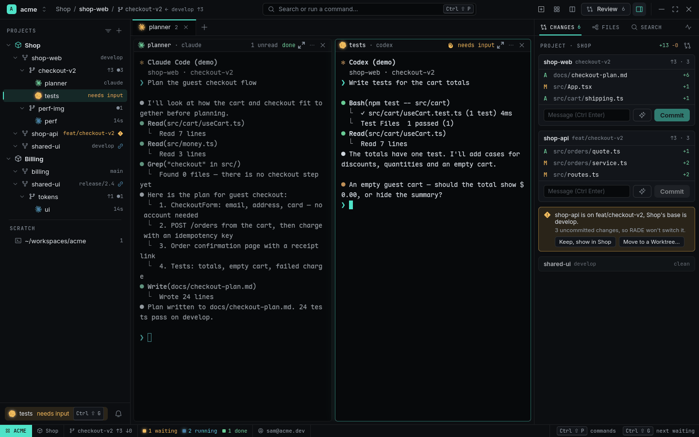

# Projects and Worktrees

A **Project** groups the repositories (Sources) one product needs, each pinned to one base
branch. A **Worktree** is one checkout where a piece of work happens. Together they decide where
new work starts, what a Review compares against and where a PR goes.

New to the model? Read [Organizing Workspaces and Projects](../guides/organizing-workspaces-and-projects.md)
first; this page is the reference.

<picture>
  <source media="(prefers-color-scheme: light)" srcset="../images/project-home-light.png">
  
</picture>

## Sources

A Source is a git repository (or plain folder) registered in a Workspace.

```sh
rade source add ~/workspaces/acme/shop-web           # an existing folder
rade source add acme/shop-api --workspace acme       # cloned with the Workspace's gh login
rade source list
rade source rename shop-web "Storefront"             # display name only
rade source remove shop-web                          # forgets it; never deletes files
```

`Ctrl+Shift+N` adds one from a folder picker.

## Projects and Source links

```sh
rade project add Shop --source shop-web:develop --source shop-api:develop --source shared-ui:develop
rade project show shop          # each link: base, checkout, HEAD, ahead/behind, drift
rade project plan Shop --source shared-ui:develop   # what checkouts it would make; writes nothing
rade project link add shop billing --base main
rade project link set-base shop shared-ui release/2.5
rade project link remove shop billing
```

A Project is a plain file, `<workspace>/.rade/projects/<id>/project.toml`, that you can commit,
share or edit by hand:

```toml
name = "Shop"

[[source]]
id = "shop-web"
base = "develop"

[[source]]
id = "shared-ui"
base = "develop"
checkout = "auto"     # auto (default) | main | a path
```

Each command changes only its own lines of the file and never creates, moves or deletes a
checkout. In the UI: **New Project** (`+` at the top of the Navigator), and on a Project's menu
**Add Source…**, **Change base…** and **Settings**. Each shows the checkout plan before you
confirm.

<picture>
  <source media="(prefers-color-scheme: light)" srcset="../images/new-project-light.png">
  
</picture>

<picture>
  <source media="(prefers-color-scheme: light)" srcset="../images/change-base-light.png">
  
</picture>

Changing a link's base never rewrites the base its existing Worktrees were cut from.

**A new folder without git.** Add it from *Add source… › A folder…*: its row says *Not a git
repository* and offers **Initialize**, which runs only `git init -b <base>` (nothing is added or
committed). It links on its own folder right away; New Worktree waits for its first commit. If you
cancel the dialog, the folder is not left behind as a Source.

### Removing a Project

**Remove Project…** on a Project's menu (or `rade project remove shop`, `--dry-run` to look first)
lists what happens, then: the Project's folder and `project.toml` are deleted, its Project
checkouts that no other Project uses are removed if they're clean (one with uncommitted changes is
kept and named), Panes running in them close, and its Worktrees move to **Scratch** with their base.
Repositories and Worktrees are never deleted.

Unlinking a Source or changing a link's base can leave a Project checkout nobody uses; RADE says so.
`rade project prune` (or *Prune Unused Project Checkouts…* in the palette) removes the clean ones.

### Which checkout a link uses

- The Source's own folder (**main checkout**) when it's on the link's base and no other link needs
  it at another base.
- Otherwise a **Project checkout**: a git worktree at
  `<workspace>/.worktrees/.projects/<project>/<source>` on the base. Links with the same Source and
  base share it (`shared`).

RADE decides once, records it and creates the Project checkout only when you first open a
terminal, an Agent or a Worktree on the link. It never switches, stashes or resets a checkout that
has changes.

### Base drift

If a link's checkout ends up on another branch, the link is **off base**: a warning diamond in the
Navigator, `off base · 3 changes` on Project home and a card in Changes with **Back to base**
(clean checkouts only), **Keep** and **Move to a Worktree…**.

<picture>
  <source media="(prefers-color-scheme: light)" srcset="../images/drift-light.png">
  
</picture>

## The Navigator

The left column shows the Workspace on screen:

- **Projects** → their **Source links** (name and base; a diamond when off base, a chain icon when
  another Project uses the same Source) → **Worktrees** (`↑ahead`, changed files, review state)
  → **Agents** (glyph and status).
- **Scratch**: terminals at the Workspace root and Worktrees in no Project. A Scratch Worktree
  whose branch names a Project (`shop/coupons`, or the link's base) shows `→ Shop?`; click it to
  move it there. A Worktree's menu has *Move to Project ▸* (another Project, or Scratch); when the
  new link has another base, RADE asks whether to keep comparing against the old one
  (`rade worktree move shop-web spike --project shop [--rebase-to-link]`). *Close Panes in
  Scratch…* on a repository's Scratch row closes the terminals open in its own folder.
- The **Inbox** pill at the foot.

A folded row shows its children's worst status and waiting count. `Alt+1…9` jumps to Project
1–9. The tree follows `project.toml` and branch changes within 3 seconds.

## Project home

Click a Project row: KPIs (Agents waiting / running, Worktrees, uncommitted files), the **link
table** (base, checkout, HEAD, ahead/behind, `clean` / `off base` / `also in`), the Project's
Worktrees and its recent Activity. **Open terminal** opens a shell in a link's checkout: with
several links it asks which (the one you used last first).

## Worktrees

```sh
rade worktree add shop-web checkout-v2 --project shop   # new branch checkout-v2 from Shop's base
rade worktree add shop-web hotfix --base main            # from another ref
rade worktree list shop-web
rade worktree remove shop-web checkout-v2               # refuses uncommitted changes unless --force
rade spawn --agent claude --worktree new "…"            # a new Worktree and an Agent in it
```

Or `Ctrl+Shift+B` (*New Worktree…*: name and base). New Worktrees go under
`<workspace>/.worktrees/<source>/<name>`. A Worktree records its Project and base, and its Review,
`+/−` and Create PR compare against that base — changing the link's base later doesn't rewrite it.

- **Setup command**: `setup = "npm ci"` in a repository's `.rade.toml` (or
  `[sources.<id>] setup` in a config file) runs once in each new Worktree's first terminal.
- **Worktrees made outside RADE** (`git worktree add`) show up on their own.
- **Removing** asks, refuses uncommitted or untracked changes unless forced, closes its Panes and
  offers to delete the branch.

## Related

- [Changes and PRs](changes-and-prs.md) — commit and open PRs per link.
- [Review](review.md) — a Worktree's diff against its base.
