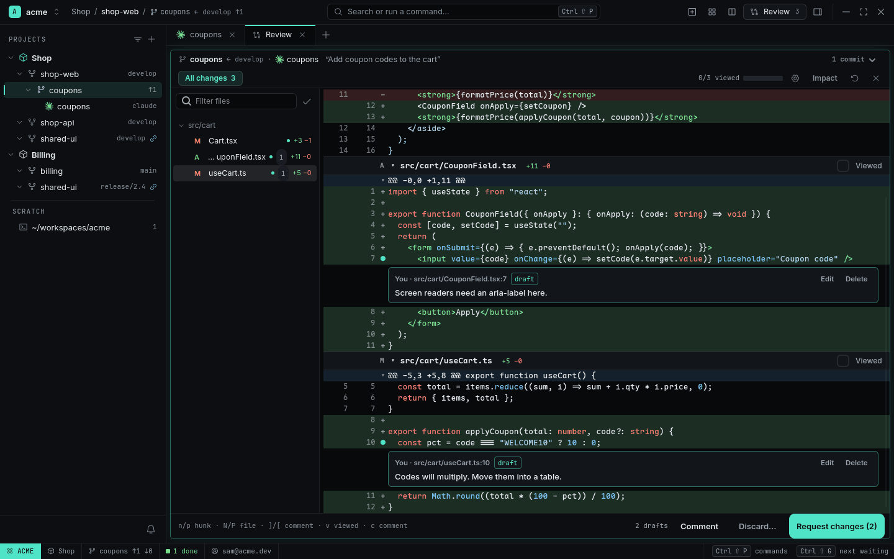
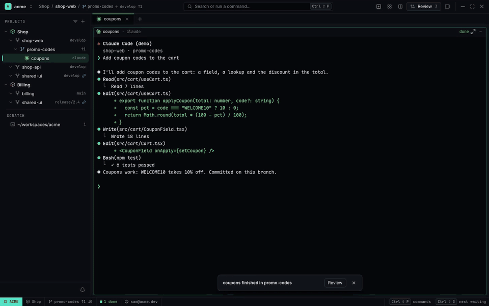
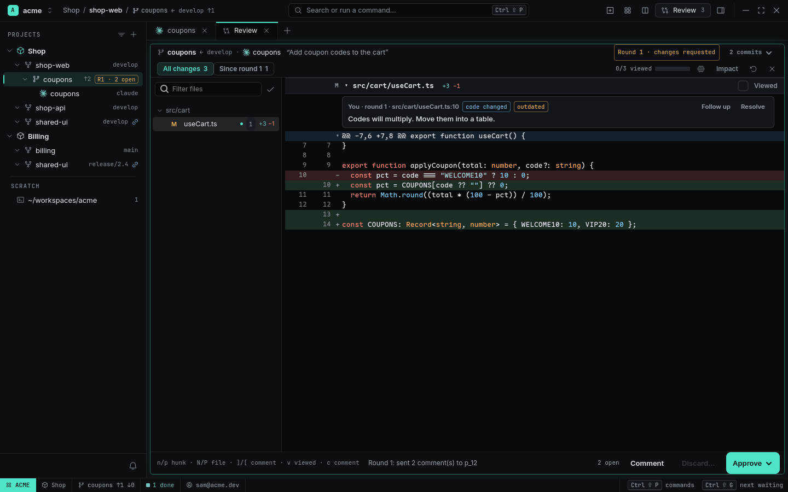
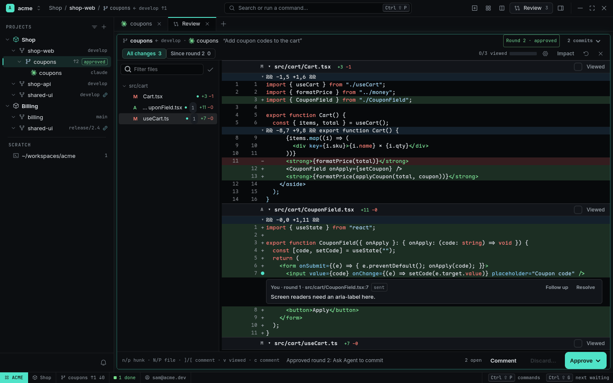

# Review

An Agent says it's done. The **Review Pane** shows what it actually changed — every file of its
Worktree against the base, in one scrolling diff — lets you comment on lines, and sends your
comments back as the next **round**. When it's right, *Approve* hands off to a commit or a PR.

<picture>
  <source media="(prefers-color-scheme: light)" srcset="../images/review-light.png">
  
</picture>


<sub>[Watch as MP4](../images/review.mp4)</sub>

## Open it

- `Ctrl+Shift+R`, or the titlebar's **Review** button (it shows how many files changed).
- The **Review** button on the Toast `coupons finished in coupons` and on its Inbox row.
- `Alt+R` on a card in [Agent Overview](agent-overview.md).
- `rade review open` from a terminal in the Worktree.

## Read

The header says whose work this is: the branch and its base (`coupons ← develop`), the Agent and
the task it was started with, and `3 commits ▾`. Below it, the scope (`All changes` or
`Since round n`), a whitespace toggle, `2/6 viewed` and Impact.

- The **files rail** is a folder tree of the changed files; lock files and generated files are
  folded into a last group. Filter it, or hide viewed files.
- Mark a file **Viewed** (`v` or its checkbox): it folds, and the Review moves to the next unread
  one. If the file changes again, it becomes unread again.
- `w` hides whitespace-only changes.
- `F12` / `Ctrl+click` on a name in the diff goes to its definition, `Shift+F12` lists references,
  `Ctrl+I` shows its type and docs — the same [code navigation](code-navigation.md) as the
  Viewer, also for removed lines.
- `i` shows **Impact**: every function the diff changes, adds or removes, with its callers
  outside the diff (and in tests) — what else this change can break.

## Comment

Select lines and press `c` (or **Comment**): the box opens right under them. `Enter` adds,
`Shift+Enter` is a new line, `Esc` cancels. Drafts can be edited or deleted. Comments follow
their lines when the file changes; when the lines are gone the comment is marked *outdated* and
still sent with the code it quoted.

## Rounds

**Request changes (n)** sends all drafts to the Worktree's Agent as one prompt headed
`Review round 1` (file, line, the quoted code and your comment for each) and records the round:
a snapshot of the files at that moment.

When the Agent's turn ends:

- the Review opens on **Since round 1**: only what changed after your comments;
- each sent comment reads `code changed` or `untouched`;
- **Resolve** a comment (it dims, with Reopen), or **Follow up** to write a new one on the same
  lines that quotes the earlier one;
- the Navigator's Worktree row shows `R1 · 2 open`.

<picture>
  <source media="(prefers-color-scheme: light)" srcset="../images/review-round2-light.png">
  
</picture>

## Approve

With no drafts left the primary button is **Approve ▾**:

| Item | Does |
|---|---|
| Ask Agent to commit | sends `Approved (review round n). Commit these changes following this repository's conventions. Do not push.` |
| Ask Agent to commit and open a PR | the same, then push and open a PR against the base |
| Commit myself… | opens [Changes](changes-and-prs.md) with the message box focused |
| Create PR… | opens the Create Pull Request dialog |
| Choose as Winner… | in a [Fan-out](fan-out.md) Worktree: opens Choose Winner with this one selected |

The round is recorded as `approved`; if the files change afterwards the header says
`changed after approval`.

<picture>
  <source media="(prefers-color-scheme: light)" srcset="../images/review-approve-light.png">
  
</picture>

The Review Pane itself never runs git: it only reads. Commits, pushes and PRs happen where you
confirm them.

## Keys

| Key | Action |
|---|---|
| `n` / `p` | next / previous hunk |
| `N` / `P` | next / previous file |
| `]` / `[` | next / previous comment |
| `v` | mark viewed |
| `c` | comment on the selected lines |
| `w` | hide whitespace changes |
| `i` | Impact |
| `Ctrl+Enter` | the primary button (Request changes / Approve) |

## For Agents

```sh
rade review status            # rounds, open comments with path:line, viewed k/n
rade review request --summary "Coupons done; WELCOME10 and VIP20 tested"   # "ready for review"
rade review add src/cart/useCart.ts:12-14 "use a lookup table"             # add a comment
rade review send                                                          # send them to the Worktree's Agent
```

`rade review request` puts the summary under the Review's header and gives you a
*Ready for review* Notification with a Review button. The `rade` skill tells agents to read
`rade review status` after a review prompt and to call `rade review request` when done.

## Related

- [Showcase: review in rounds](../showcases/review-in-rounds.md)
- [Changes and PRs](changes-and-prs.md)
