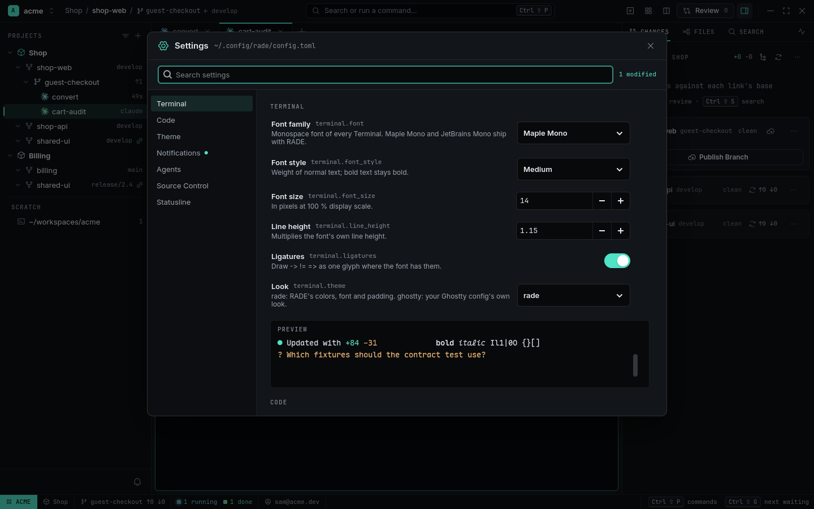

# Settings and config

Everything RADE does is configured in plain TOML files. The **Settings** page (`Ctrl+,`) edits the
app-wide ones for you, and settings that differ per company, product or repository go in layered
files next to them.

<picture>
  <source media="(prefers-color-scheme: light)" srcset="../images/settings-light.png">
  
</picture>

## Settings page

`Ctrl+,` or *Settings* in the palette. Categories: **Terminal** (font family, style, size, line
height, ligatures, look), **Code** (the font of the Viewer, Review and Markdown code), **Theme**
(`system` / `dark` / `light`), **Notifications** (desktop notifications, idle time), **Agents**
(spawn depth and children limits), **Voice** ([voice prompts](voice.md): voice agent, steps,
timeout, recording, languages) and **Statusline** (show it, system monitor). Search finds a
setting by name, description or key.

Each change is one edit of `~/.config/rade/config.toml`, checked before it's written, keeping your
comments; it applies at once — terminals reload their font while you watch the preview. A
modified row has a ↺ to reset it.

## config.toml

`~/.config/rade/config.toml` (reloaded when you save it):

```toml
desktop_notify = "smart"     # smart | always | off
idle_seconds = 5             # a hookless agent counts as done after this long without output

[appearance]
color_scheme = "system"      # system | dark | light

[terminal]
font = "Maple Mono"
font_size = 14

[limits]
max_depth = 3                # Subagents of Subagents of …
max_children = 8             # live Subagents per Agent

[keybindings]                # action = key; "" unbinds
split_right = "<Ctrl><Shift>Return"
agent_overview = "<Ctrl><Shift>space"

[agents.claude]              # change a built-in Preset
command = "claude --model opus"

[agents.reviewer]            # or add your own
command = "codex --model gpt-5.3-codex"

[scm]
draft_command = "codex exec -"   # who drafts commit messages and PRs

[fanout]
judge = "codex"

[viewer]
editor = "codium"            # Open in … from the Viewer

[browser]
chromium = "/opt/chrome/chrome"

[sources.shop-web]           # by Source id or name
setup = "npm ci"
```

The Settings page describes every app-wide key and its default; `rade config explain` lists what your files set. All keybindings: [keybindings](../keybindings.md).

## Layers

Some settings are better per Workspace, Project or repository — the agent command a company
uses, the judge for one product, a repository's setup step. These keys are **layered**:
`agents`, `scm`, `fanout`, `viewer`, `sources` and `code`. Lowest precedence first:

1. built-in defaults
2. `~/.config/rade/config.toml` — you
3. `<workspace>/.rade/workspace.toml` — a company or client
4. `<workspace>/.rade/projects/<id>/project.toml` — a product
5. `<repo>/.rade.toml` — the repository (committed with the code)

Tables merge key by key; a value replaces. App-wide keys (keybindings, limits, notifications, fonts,
theme) count only in `config.toml` and are reported `ignored (app-wide)` elsewhere. A broken file
is reported by name and skipped; the rest still applies.

### Trust

A repository's `.rade.toml` comes from git — anyone with push access could put a `setup` command
in it. RADE ignores it until you trust its exact content:

```sh
rade config trust shop-web
```

Any later change to the file makes it untrusted again (a new Worktree's first terminal says so).

### Why is it set to that?

```sh
rade config explain agents.claude.command --project shop
rade config explain --pane tests          # everything set in files, for that Pane
```

prints the effective value, every layer's value with ✓ on the winner, and the context. Or ask
an agent: `rade setup` installs the `rade-config` skill ("use Opus for the acme Workspace only").

## Fonts and look

RADE ships Inter and JetBrains Mono for its interface and **Maple Mono** for terminals (all under
the SIL Open Font License); nothing is installed system-wide. The terminal **Look** `rade` uses
RADE's colours and padding in both themes; `ghostty` uses your `~/.config/ghostty/config`.
