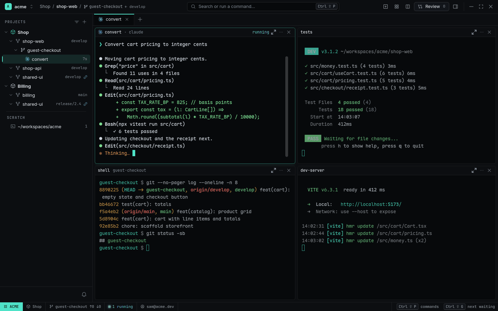
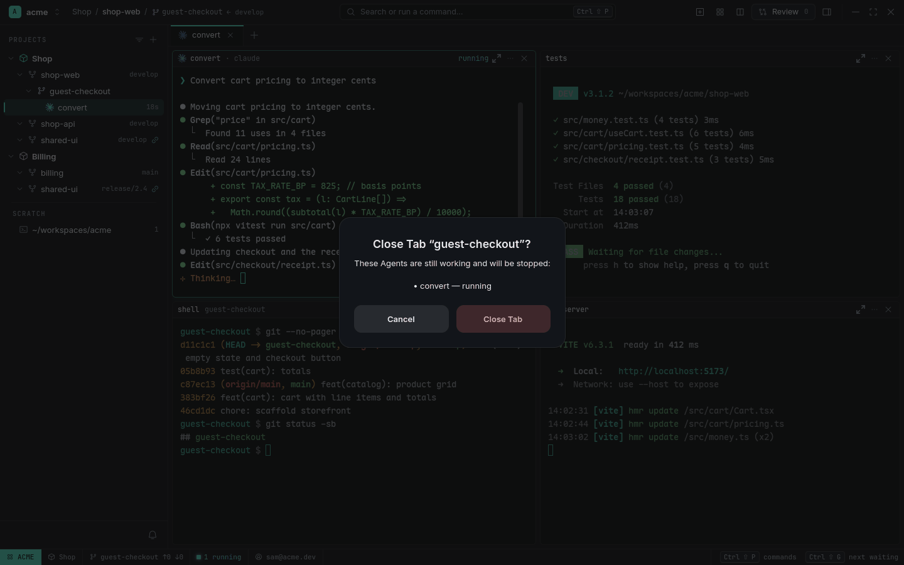
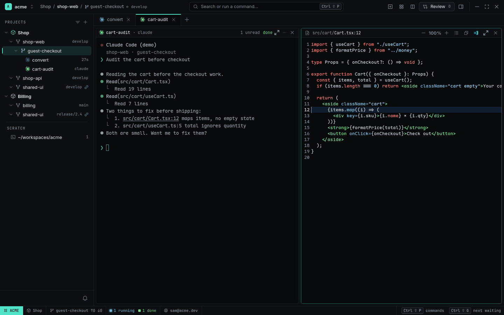

# Terminals and layout

Every terminal in RADE is [Ghostty](https://ghostty.org)'s GPU renderer, embedded: the same speed,
fonts and escape-sequence support as standalone Ghostty, with RADE's Tabs, splits and Agent
tracking around it.

<picture>
  <source media="(prefers-color-scheme: light)" srcset="../images/splits-light.png">
  
</picture>

## Tabs and Panes

Each [Worktree](projects-and-worktrees.md) has its own Tabs; each Tab holds Panes split right or
down. A new terminal always starts in the Worktree's root, whichever Pane was focused.

| Keys | Action |
|---|---|
| `Ctrl+Shift+T` | New Tab |
| `Ctrl+Shift+Enter` / `Ctrl+Shift+D` | Split right / down |
| `Ctrl+Shift+H` `J` `K` `L` | Focus left / down / up / right |
| `Ctrl+Shift+Z` | Zoom the Pane over its Tab (again: back) |
| `Ctrl+Shift+W` | Close the Pane |
| `Ctrl+Shift+PgUp` / `PgDn` | Previous / next Tab |
| `Ctrl+Shift+F` | Search the terminal's screen and scrollback |

Right-click a Tab for Rename…, Duplicate, Close, Close Other Tabs, Close Tabs to the Right.
Right-click a terminal for Open "*path*", Copy, Paste, Search…, Clear, Split, Zoom, Rename Pane…
and Close Pane. (A program that uses the mouse gets the click; `Shift`+right-click opens the menu
over it.)

In a Tab with two or more Panes every Pane has a header with Zoom, ⋯ and ✕. Closing a Tab or a
terminal from the UI asks first and names any Agent that's still working.

<picture>
  <source media="(prefers-color-scheme: light)" srcset="../images/close-confirm-light.png">
  
</picture>

An Agent's Tab is named after its session: the title Claude Code or Codex gives it (cut to 24
characters; hover for all of it), or the Pane's name if you gave one. With several Agents in a
Tab, the first one's (the parent's in an Agent Grid) names it. Double click a label to rename it;
your name sticks.

## Open files from terminal output

`Ctrl+click` a path in any terminal — `src/cart/Cart.tsx`, `src/cart/Cart.tsx:12`,
`~/notes.md`, relative to the terminal's folder — to open it in a [Viewer](viewer-files-search.md)
beside it, at that line. `Ctrl+Shift+click` opens it in a new Viewer to the side. URLs open in your
browser. Agents do the same with `rade open src/cart/Cart.tsx:12`.

In a narrow Pane a long path or URL runs onto the next row — wrapped by the terminal, or by
Claude Code / Codex at their own width with an indent. `Ctrl+click` any of its rows: RADE joins
the pieces and opens the whole path (when that file exists) or URL.

<picture>
  <source media="(prefers-color-scheme: light)" srcset="../images/ctrl-click-light.png">
  
</picture>

## Paste images, type newlines

- `Ctrl+Shift+V` with an image on the clipboard saves it to `~/.cache/rade/paste/` and pastes the
  file's path (cleaned up after 7 days). Drag image files onto a terminal to paste their paths.
- `Ctrl+V` goes to the program untouched, so agents that handle image paste themselves still can.
- `Shift+Enter` inserts a newline in agent prompts.

## Pause a Source

Right-click a Source in the Navigator → **Pause** stops every process in all its Worktrees but
keeps the Tabs and Panes, each showing *Paused — Resume*. Resume starts them again the way Session
Restore would: Agents resume their sessions. Handy when a repository's dev servers and agents eat
the machine and you need it for something else.

## Looks

The terminal font, size, line height and ligatures are in [Settings](settings-and-config.md)
(`Ctrl+,`), with a live preview; RADE ships Maple Mono and uses it by default. The **Look**
setting picks `rade` (RADE's colours, font and padding, following its light and dark theme) or
`ghostty` (your own `~/.config/ghostty/config`).

## System monitor

The Statusline's system cell shows CPU, memory, GPU (when readable) and network. Click it for the
five busiest Panes — click one to focus it. Turn it off in Settings (`system_monitor = false`).
