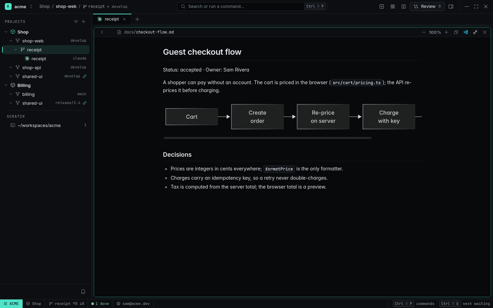
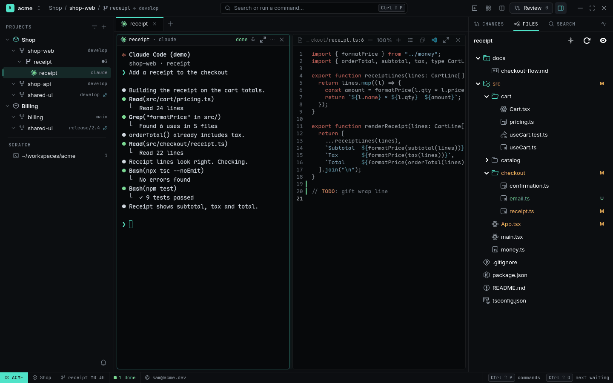
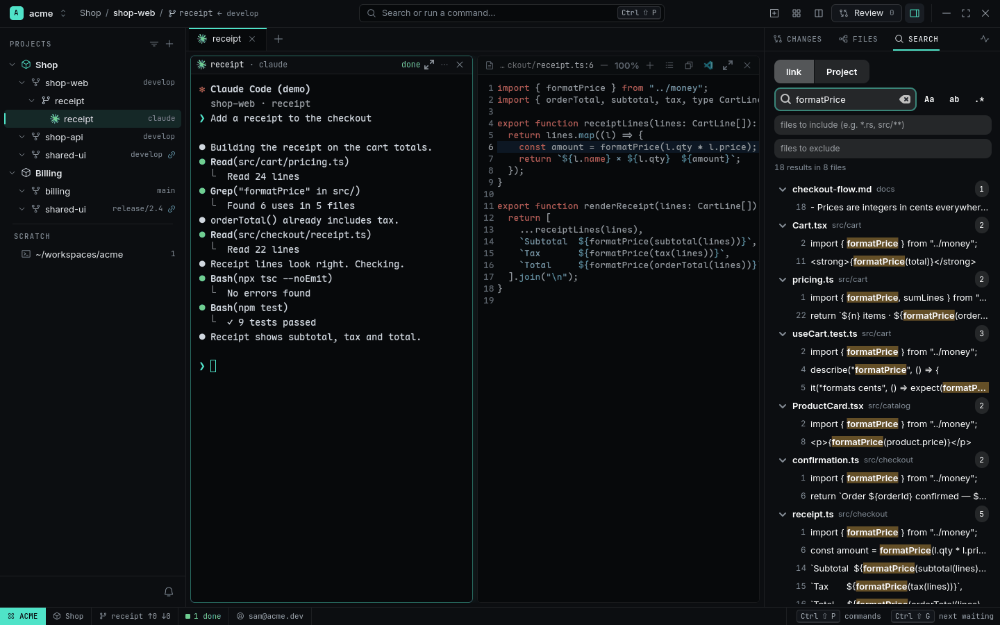
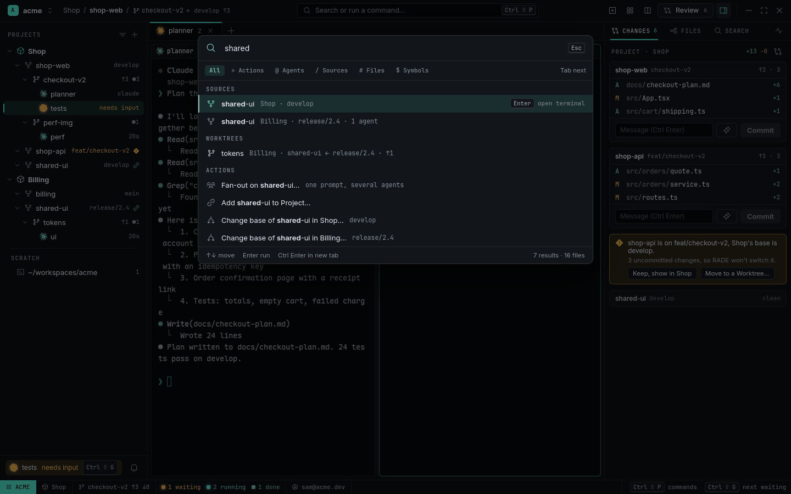

# Viewer, files and search

RADE is not an editor — your agents edit, and you keep your editor for the rest. But reading is
half the job, so RADE shows files, Markdown, HTML and PDFs in **Viewer** Panes next to your
terminals, with a file tree, project-wide search and a command palette.

<picture>
  <source media="(prefers-color-scheme: light)" srcset="../images/markdown-light.png">
  
</picture>

## Viewer

Open a file by `Ctrl+click`ing its path in a terminal, from the Files tree, Search, the palette, or
`rade open src/cart/Cart.tsx:12` (agents use this to show you something).

- **Code**: syntax-highlighted, at the line, reloads when the file changes, with
  [code navigation](code-navigation.md) and an Outline.
- **Markdown**: rendered, with tables, task lists, highlighted code, **Mermaid** diagrams and
  relative images; links to other `.md` files open in the same Viewer with Back. Everything is
  bundled — it works offline and loads nothing remote.
- **HTML**: rendered (its own scripts run; `[viewer] html_scripts = false` to stop them), with a
  Source toggle for the markup.
- **PDF**: pages, zoom, search, text selection.
- **Images**: fitted, with zoom.

Viewers are ordinary Panes: split, resize, zoom (`Ctrl+Shift+Z`), several per Tab, restored on
restart. Content zooms with `Ctrl+scroll`, `Ctrl++` / `Ctrl+−`, `Ctrl+0`. `Esc` closes.
`Ctrl+Shift+click` (or *Open to the Side*) opens a second Viewer instead of replacing the file.
The header has **Open in VS Code** (`[viewer] editor`, default `code`; your `$EDITOR` when that's
missing) and Copy path.

[Watch as MP4](../images/files.mp4)

## Files

The Inspector's **Files** tab (`Ctrl+Shift+E` toggles the Inspector) shows the focused Worktree's
tree with `.gitignore` applied (toggle to show ignored files), git status colours and file icons.
Changed files are marked (`M`, `A`, `?`) and so are the folders above them, so you see at a glance
what an Agent touched. Click to open, middle-click to open to the side. The tree follows the
focused Pane: focus another Agent and it shows that Agent's Worktree.

<picture>
  <source media="(prefers-color-scheme: light)" srcset="../images/files-light.png">
  
</picture>

## Search

The Inspector's **Search** tab (`Ctrl+Shift+S`) searches the focused link's checkout or the whole
Project: regular expressions, match case, whole word, include / exclude globs (`src/**`, `*.ts`),
`.gitignore` applied. Results are grouped by file; a click opens the Viewer at the line. It runs on
every core and stops at 2,000 matches.

<picture>
  <source media="(prefers-color-scheme: light)" srcset="../images/search-light.png">
  
</picture>

## Command palette

`Ctrl+Shift+P` (or `Ctrl+K` outside a terminal, or the titlebar's search field) finds and runs
anything: Panes and Tabs by name, Worktrees, Source links and Projects, files, symbols, and every
action — with its key shown.

<picture>
  <source media="(prefers-color-scheme: light)" srcset="../images/palette-light.png">
  
</picture>

| Prefix | Finds |
|---|---|
| `>` | actions (Spawn Agent…, Fan-out…, New Worktree…, Settings, Usage…) |
| `/` | Sources, links and Worktrees |
| `@` | Panes and Tabs |
| `#` | files |
| `$` | symbols |

`Tab` cycles the categories. Actions that need input (Spawn Agent…, New Worktree…, Fan-out…,
Create Workspace…) show a form right in the palette. Matching is fuzzy and ignores accents.
Recently used items come first.
