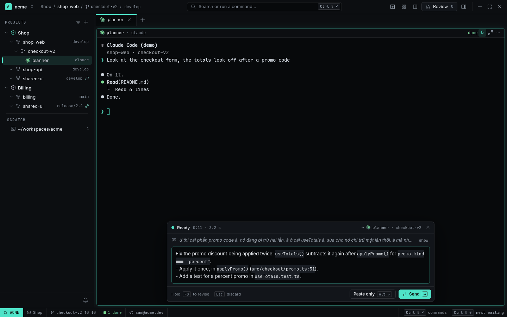

# Voice prompts

Talk to an agent instead of typing to it. Hold `F8` on an Agent Pane and say what you want, fillers,
false starts and all ("ừ thì cái phần promo code á…"). When you let go, a small read-only voice
agent turns your words into a short, clear prompt. It reads the Pane's session and, when it needs
to, the checkout, so it can tell that "use totals" means `useTotals()`. Hold `F8` again to change
the prompt by voice ("drop the test line, keep the API"), then press `Enter` to send it.

<picture>
  <source media="(prefers-color-scheme: light)" srcset="../images/voice-light.png">
  
</picture>

## How it works

1. **Hold `F8`** (or click the mic in the Pane header) on an Agent Pane. The **Voice Composer**
   opens at the bottom of that Pane and shows your words as you speak. The Statusline shows
   `REC 0:06`.
2. **Let go.** The **Voice Draft** streams in: one line with the goal, up to five `- ` bullets,
   code as `` `name` `` or `` `path:line` ``. While it drafts, a line under the text shows what the
   voice agent is reading (`Read src/checkout/useTotals.ts · 2 / 6`).
3. **Revise or edit.** Hold `F8` again and say what to change. The voice agent rewrites the whole
   draft and highlights the words that changed. You can also click into the draft and type.
   Anything it couldn't work out is marked `[?] "your words"`.
4. **Send.** `Enter` sends the draft to the agent, the same as typing it and pressing Enter.
   `Alt+Enter` only pastes it, so you can finish it in the agent's own input. `Esc` discards the
   draft; after you've edited it, press `Esc` twice.

A quick tap of `F8` (shorter than a quarter second) starts a take that runs until the next tap, for
when you'd rather not hold the key. Voice works on Agent Panes only, one composer at a time.

| Keys | Action |
|---|---|
| hold `F8` | Talk; let go to draft (or to revise, when there is a draft) |
| tap `F8` | Start / stop talking |
| `Enter` | Send the draft to the agent |
| `Alt+Enter` | Paste the draft without Enter |
| `Shift+Enter` | New line in the draft |
| `Esc` | While talking: drop the take. While drafting: stop. Ready: discard (twice after edits) |

## Set up speech-to-text

RADE records with `pw-record` (PipeWire) and sends each take to a speech-to-text server that speaks
OpenAI's transcription API. It does not bundle a model. The default server address is a local
[whisper.cpp](https://github.com/ggml-org/whisper.cpp) server, which runs on your own GPU and keeps
the audio on your machine.

**Local whisper.cpp with an NVIDIA GPU** (one time; about 1.6 GB of model):

```sh
git clone --depth 1 https://github.com/ggml-org/whisper.cpp ~/.local/src/whisper.cpp
cd ~/.local/src/whisper.cpp
cmake -B build -DGGML_CUDA=1 -DCMAKE_BUILD_TYPE=Release
cmake --build build -j --target whisper-server
mkdir -p ~/.local/share/whisper
curl -L -o ~/.local/share/whisper/ggml-large-v3-turbo.bin \
  https://huggingface.co/ggerganov/whisper.cpp/resolve/main/ggml-large-v3-turbo.bin
```

Run it as a user service, so it is there whenever RADE is
(`~/.config/systemd/user/whisper.service`):

```ini
[Unit]
Description=whisper.cpp speech-to-text for RADE

[Service]
ExecStart=%h/.local/src/whisper.cpp/build/bin/whisper-server -m %h/.local/share/whisper/ggml-large-v3-turbo.bin --host 127.0.0.1 --port 8178 --inference-path /v1/audio/transcriptions -l auto
Restart=on-failure

[Install]
WantedBy=default.target
```

```sh
systemctl --user enable --now whisper.service
```

Keep `-l auto` (or a language such as `-l vi`). Without `-l`, whisper-server assumes English for
every request that names no language. On an RTX 5080, a 14-second take is transcribed in about 0.2 s.
Without a GPU, drop `-DGGML_CUDA=1` and use a smaller model (`ggml-small.bin`); takes then
take a few seconds. For Vietnamese only, VinAI's
[PhoWhisper](https://github.com/VinAIResearch/PhoWhisper) models can be converted for whisper.cpp.

**A hosted service** (OpenAI, Groq, or anything with the same API) works too. The audio and the
vocabulary hint (names from your session and checkout) are then sent to that service. Keep the key
in your keyring and let RADE ask for it:

```toml
[voice]
stt_url = "https://api.openai.com/v1/audio/transcriptions"
stt_model = "gpt-4o-transcribe"
stt_key_command = "secret-tool lookup service openai"
```

If no server answers, the composer says `No speech-to-text server at 127.0.0.1:8178` and links to
the Voice settings.

## What the voice agent sees

The voice agent is Claude Code in headless mode, with Haiku as its model. RADE gives it:

- the Pane's session: the last exchanges of the agent's transcript (Claude Code) or rollout
  (Codex), text only. A Pane without a session gives its screen instead.
- the checkout: branch, `git status`, the diff's file list, the last commit subjects, `CLAUDE.md`
  / `AGENTS.md`, and the folder layout.
- the file open in the Tab's Viewer, if any.

It may **read, search and list** files of the checkout, within the step limit, and nothing else:
no edits, no commands, no web. It runs:

- without saving a session;
- without your Claude Code hooks;
- without RADE's Pane variables, so it never changes the Pane's status.

Everything you say for one draft, revisions included, goes to the same process, so it doesn't
re-read the code. RADE stops that process when you send or discard. No audio is written to disk.

With `agent = "codex"`, Codex (`codex exec --ephemeral`, read-only sandbox) writes the draft
instead, as one process per revision.

## Settings

Settings (`Ctrl+,`) › **Voice**:

| Setting | Key | Default |
|---|---|---|
| Voice agent | `voice.agent` | `claude` (`codex`) |
| Voice agent reads files | `voice.tools` | `read` (`none`: only what RADE gives it) |
| Max steps | `voice.max_turns` | `6` (1–20; Claude Code only) |
| Draft timeout (seconds) | `voice.timeout_secs` | `60` (10–300) |
| Max recording (seconds) | `voice.max_recording_secs` | `120` (10–600) |
| Live words | `voice.live_preview` | on (one request per second while you talk) |
| Draft language | `voice.draft_language` | `same` (the language you spoke; `en`: always English) |
| Speech language | `voice.stt_language` | `auto` (`vi`, `en`; any ISO 639-1 code in `config.toml`) |

Only in `config.toml`:

```toml
[voice]
model = ""                 # "" = haiku (Claude Code) / Codex's default
agent_command = ""         # replaces the built-in voice agent command
stt_url = "http://127.0.0.1:8178/v1/audio/transcriptions"
stt_model = "whisper-1"    # ignored by whisper.cpp
stt_key_command = ""       # prints the API key; never stored by RADE
record_command = "pw-record --rate 16000 --channels 1 --format s16 -"  # raw 16 kHz mono s16le on stdout
```

`[voice]` is read from your own `config.toml` only. A Workspace, Project or repository
`.rade.toml` can't set it, because it decides which commands run and where your audio and code
context go (`rade config explain voice` says `ignored (user config only)`). The key is `F8` by
default; change it with `voice = "<accelerator>"` under `[keybindings]`.
