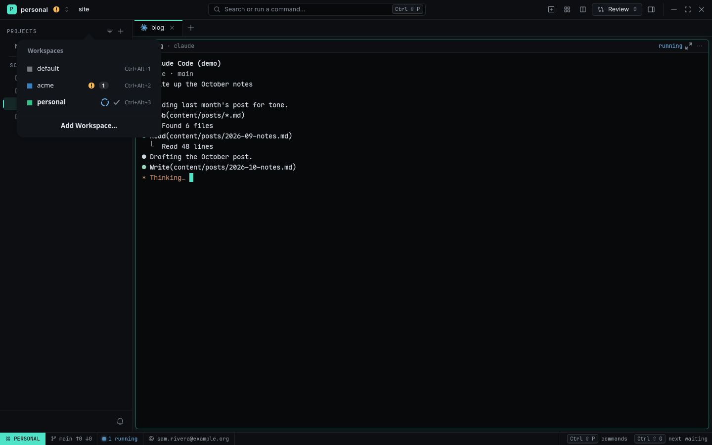
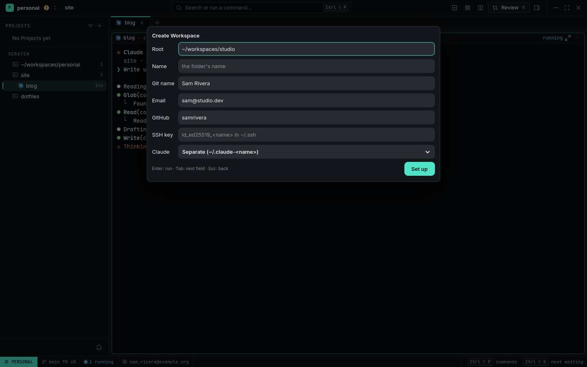
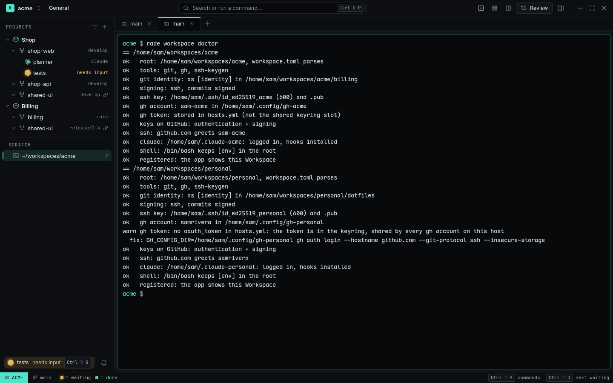

# Workspaces and identity

A **Workspace** is a working identity — a company, a client, your personal work — rooted at a
folder such as `~/workspaces/acme`. Every Terminal, Agent, Push and PR inside it gets that
identity: its git name and email, its GitHub login, its SSH key and its Agent Accounts.

<picture>
  <source media="(prefers-color-scheme: light)" srcset="../images/switcher-light.png">
  
</picture>

## Add and switch

```sh
rade workspace add ~/workspaces/acme      # Sources under the folder move in
rade workspace list
rade workspace switch acme
```

One window shows one Workspace; the others keep running. Switch with the button at the top left,
`Ctrl+Alt+1…9`, or the palette. When an Agent in a hidden Workspace needs you, the button shows an
amber `!` and the Toast or desktop notification names the Workspace (`[acme] tests needs input`);
clicking it switches there. The `default` Workspace, rooted at `$HOME`, always exists.

## workspace.toml

`<root>/.rade/workspace.toml` declares the identity. Everything in it is optional:

```toml
name = "acme"
color = "green"

[identity]
git_name = "Sam Rivera"
git_email = "sam@acme.dev"
github = "sam-acme"            # the login gh should be using here
ssh_key = "id_ed25519_acme"    # in ~/.ssh
sign = "ssh"                   # sign commits with that key

[env]                          # given to every Pane, Push, Pull, PR in this Workspace
GH_CONFIG_DIR = "~/.config/gh-acme"

[clone]
default_owner = "acme"         # rade source add shop-web → acme/shop-web

[[account]]                    # Agent Accounts, see accounts-and-usage.md
agent = "claude"
name = "acme-work"
config_dir = "~/.claude-acme"
default = true
```

RADE never runs `gh auth switch` or touches a global login: each Pane simply gets its
Workspace's `[env]`.

## Set it up on a machine

```sh
rade workspace setup ~/workspaces/acme --name acme \
  --git-name "Sam Rivera" --email sam@acme.dev --github sam-acme --claude separate --dry-run
```

`setup` makes the identity real, filling only what's missing:

1. `workspace.toml` (missing keys only) and the `.worktrees` folder;
2. `<root>/.gitconfig` with your name, email, `core.sshCommand` for the key and SSH signing, and
   an `includeIf "gitdir:<root>/"` block in `~/.gitconfig` (unless you already have one);
3. the SSH key (`ssh-keygen -t ed25519`) if missing;
4. a separate `gh` login in the Workspace's `GH_CONFIG_DIR`, in your terminal, if needed;
5. the key on your GitHub account, for authentication and signing;
6. Agent hooks in the Workspace's agent config dirs.

It shows a diff of every file it edits, keeps a backup, never overwrites a value you set, and
prints `nothing to do` the second time. `--dry-run` only shows the plan. From the palette,
**Create Workspace…** fills the same command in a form and runs it in a visible terminal (so the
GitHub device login is visible).

<picture>
  <source media="(prefers-color-scheme: light)" srcset="../images/create-workspace-light.png">
  
</picture>

Already configured by hand? `rade workspace import ~/workspaces/acme` writes `workspace.toml` from
what your machine does today (git config, the SSH key, the `gh` account, shell rc exports) and
registers it. Moving to a new laptop: commit `<root>/.rade` somewhere and run
`rade workspace setup ~/workspaces/acme --from <git-url>`.

## Check it

```sh
rade workspace doctor          # every Workspace; or: rade workspace doctor acme
```

<picture>
  <source media="(prefers-color-scheme: light)" srcset="../images/doctor-light.png">
  
</picture>

Twelve checks, each `ok` / `warn` / `FAIL` with the command that fixes it: the root, tool versions,
git identity inside a Source, signing, the SSH key and its mode, `gh api user` in the Workspace's
`GH_CONFIG_DIR`, the token being in that dir, the key on the account, `ssh -T` with only that key,
the Claude login and hooks, a shell rc file that overrides `[env]`, and the app having the
Workspace registered. It never reads private keys or prints tokens.

## Clone into a Workspace

```sh
rade source add shop-web --workspace acme              # acme/shop-web via default_owner
rade workspace clone --workspace acme shop-web shop-api shared-ui
```

Clones run under the Workspace's `gh` login and SSH key and land under its root.

## Let an agent do it

`rade setup` installs the `rade-workspace` skill: ask Claude Code "set up ~/workspaces/acme for
my work account" and it reads your machine, runs `setup --dry-run`, shows you the plan, runs it
and repeats `doctor` until it passes. It never edits `~/.gitconfig`, `~/.ssh` or `gh` folders by
hand.

## Related

- [Organizing Workspaces and Projects](../guides/organizing-workspaces-and-projects.md)
- [Agent Accounts and usage](accounts-and-usage.md)
- [Showcase: two companies, one laptop](../showcases/two-companies-one-laptop.md)
