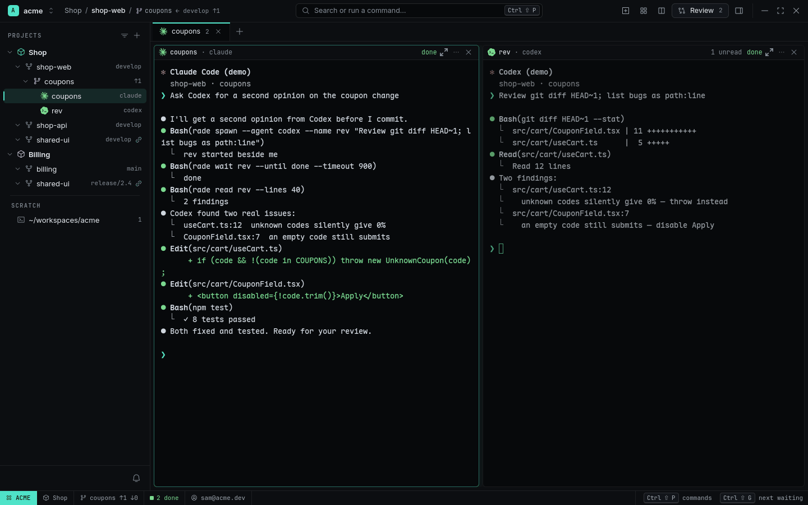
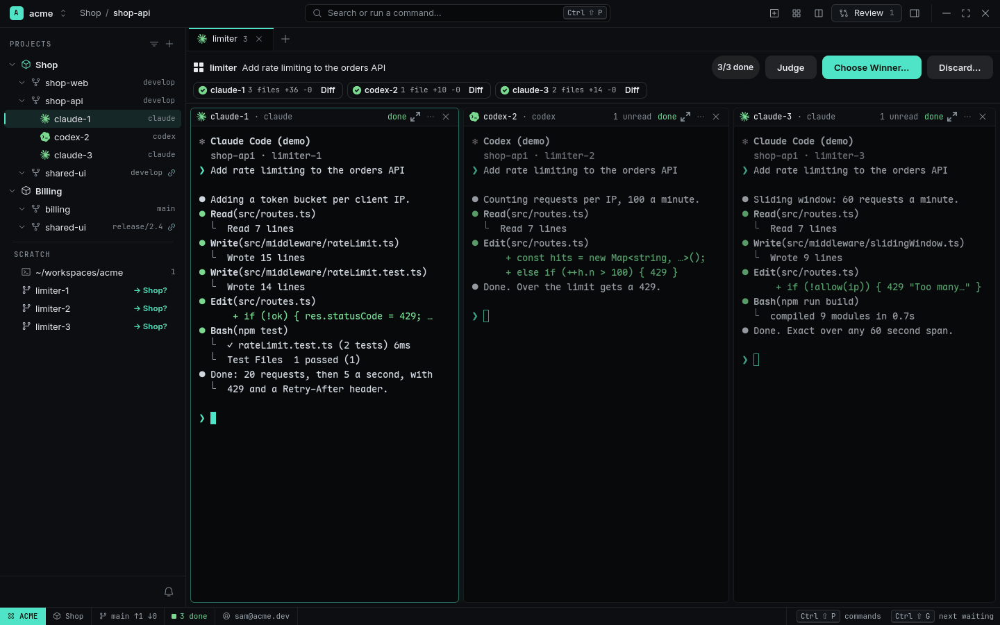
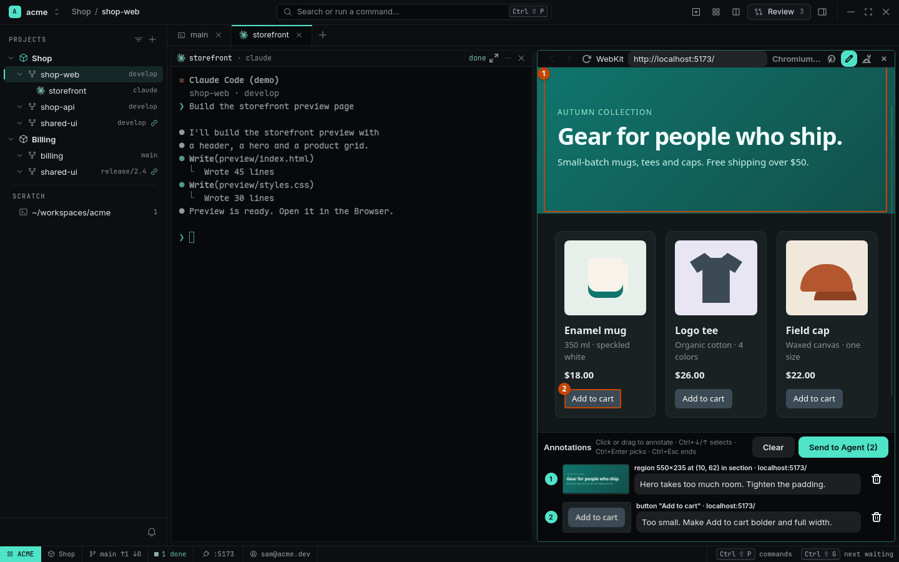

# Showcases

Real workflows, start to finish. Each one ends with the features it used.

| | |
|---|---|
|  | **[Claude asks Codex for a review](claude-asks-codex-for-a-review.md)** One agent starts another, waits for its findings and fixes them — no copy-paste. |
|  | **[Review in rounds](review-in-rounds.md)** Comment on an agent's diff, send it back, see only what changed, approve. |
|  | **[Fan out and pick a winner](fan-out-pick-a-winner.md)** Three agents, one prompt, a read-only judge, and you keep the best. |
|  | **[Fix a UI bug with annotations](fix-ui-with-annotations.md)** Point at what's wrong on the page; the agent gets selector, screenshot and console errors. |
|  | **[One feature across two repositories](one-feature-across-repos.md)** A Project, a Worktree and an Agent per repository, one Changes page. |
|  | **[Two companies, one laptop](two-companies-one-laptop.md)** The right git email, GitHub account and agent login per folder — and their limits. |

Screenshots and recordings are made by `scripts/demo/` with a scripted demo agent and made-up
repositories, so they can be regenerated for every release.
