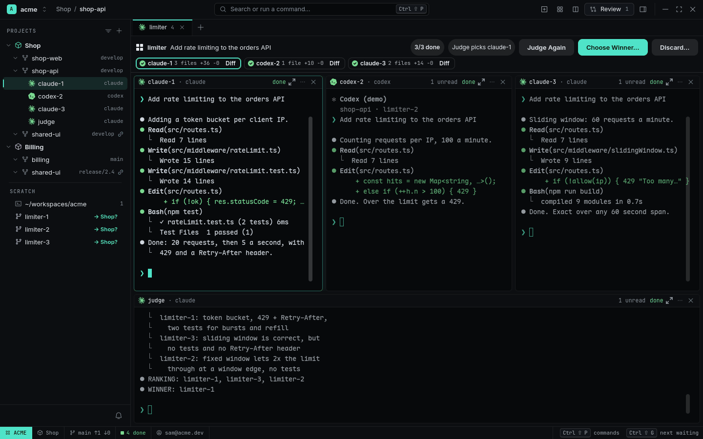

# Fan out and pick a winner

**The idea:** for a change with more than one reasonable design, don't argue with one agent —
let three try, have a fourth judge, and keep the best.

<picture>
  <source media="(prefers-color-scheme: light)" srcset="../images/fanout-light.png">
  
</picture>


<sub>[Watch as MP4](../images/fanout.mp4)</sub>

## 1. One prompt, three Agents

```sh
rade fanout --source shop-api --agents claude,codex,claude --name limiter "Add rate limiting to the orders API"
```

(or **Fan-out…** in the palette or the `+` menu). RADE makes Worktrees `limiter-1`…`limiter-3`
from the same commit, runs the setup command in each, and opens one Tab with all three Agents
side by side. The bar on top shows the prompt, `0/3 done` and a chip per Agent. Here one
writes a token bucket with tests, one a fixed window, one a sliding window.

## 2. Compare

As each finishes, its chip shows its `+/−`. **Diff** opens that Worktree's Review, with
[Impact](../features/code-navigation.md#impact): what each version's changes can break.

## 3. Judge

**Judge** starts a read-only Agent that sees the task and all three diffs under neutral names, in
random order, with their Impact. It ranks them and ends with `WINNER: <name>`, which RADE
pre-selects.

<picture>
  <source media="(prefers-color-scheme: light)" srcset="../images/fanout-verdict-light.png">
  
</picture>

## 4. Keep the best

**Choose Winner… → Squash** stages the winner's whole result on your branch — you commit it
after a last look. RADE then offers to remove the other Worktrees and branches. Or **Keep** the
winner's Worktree and continue there.

## Why it works

- Each attempt is isolated in its own Worktree; nothing collides.
- The Judge can't edit anything, and doesn't know which agent wrote what.
- RADE never commits for you.

## What you used

[Fan-out](../features/fan-out.md) · [Review](../features/review.md) ·
[Projects and Worktrees](../features/projects-and-worktrees.md)
