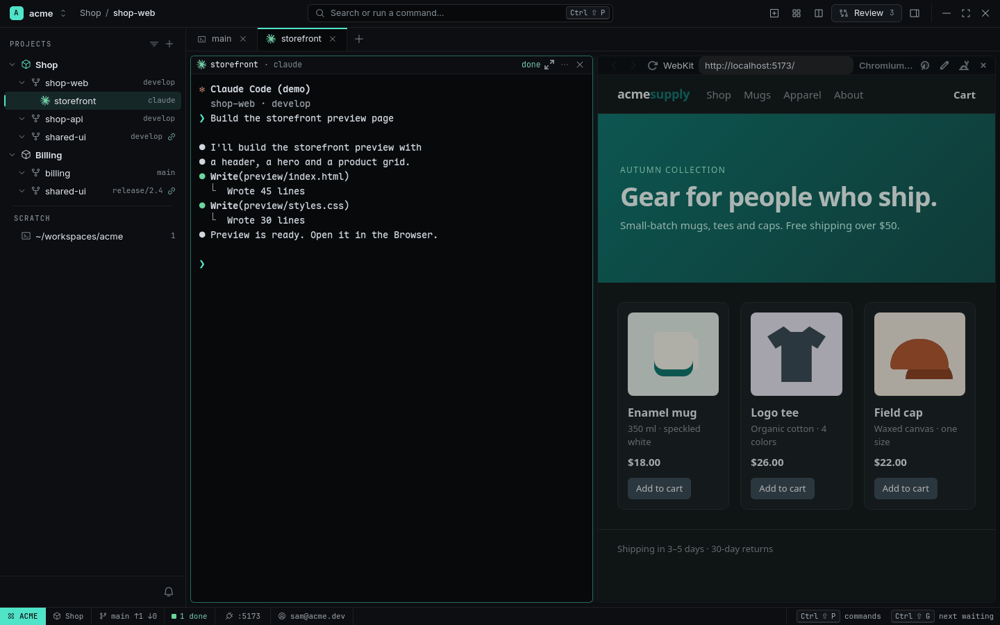

# Fix a UI bug with annotations

**The idea:** describing *where* something is wrong on a page takes longer than fixing it. Point
at it instead, and let the agent find it in the code.


<sub>[Watch as MP4](../images/annotate.mp4)</sub>

## 1. The page beside the Agent

The dev server runs in a Pane; `Ctrl+Shift+O` opens a Browser Pane on its port next to the Agent.

<picture>
  <source media="(prefers-color-scheme: light)" srcset="../images/browser-light.png">
  
</picture>

## 2. Point and comment

Turn on annotate mode (the pencil in the Browser's header, or `Ctrl+Shift+A`). Click the button
that looks wrong and write *"Use the brand color"*. Drag over the empty area under the grid and
write *"Too much padding"*.

<picture>
  <source media="(prefers-color-scheme: light)" srcset="../images/annotate-light.png">
  
</picture>

## 3. Send to Agent

**Send to Agent (2)** pastes one prompt into the Agent: for each note the page URL, a stable CSS
selector, the element's text and box, a cropped screenshot and the page's recent console errors.
The Agent finds the component, fixes it, and checks its own work:

```sh
rade browser reload
rade browser snapshot
rade browser screenshot /tmp/after.png
```

## Why it works

- The selector and the screenshot are what the agent needs to find the element in the code —
  no "the second button on the left, under the header".
- Console errors come along for free.
- Annotations survive reloads and restarts until you send them.

## What you used

[Browser and Annotations](../features/browser.md) · [Agents](../features/agents.md)
