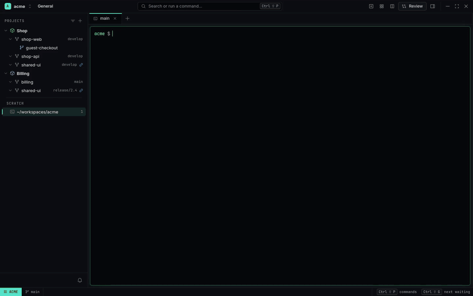
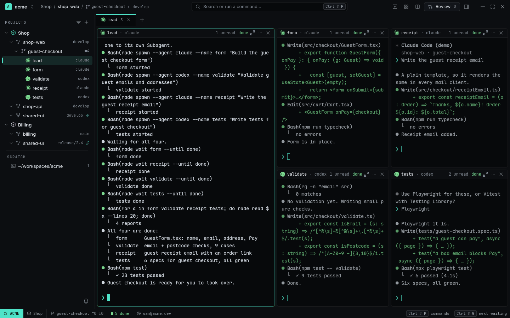

# One agent, a team of agents

**The idea:** a feature has parts that don't depend on each other. Instead of one agent doing them
one after another — or you opening four terminals and pasting four prompts — the agent you're
talking to hands each part to a Subagent of its own, Claude Code or Codex, and waits for all of
them. You watch the whole team in one Tab.


<sub>[Watch as MP4](../images/grid.mp4) · [Narrated, on YouTube](https://www.youtube.com/watch?v=YPz3ZE4oLxo)</sub>

## What happens

1. Claude Code (`lead`) runs in Worktree `guest-checkout` of Project Shop. You ask it:

   > Split the guest checkout across four Subagents

2. It starts one Subagent per part, from its own terminal:

   ```sh
   rade spawn --agent claude --name form     "Build the guest checkout form"
   rade spawn --agent codex  --name validate "Validate guest emails and addresses"
   rade spawn --agent claude --name receipt  "Write the guest receipt email"
   rade spawn --agent codex  --name tests    "Write tests for guest checkout"
   ```

   Each opens **in the lead's Tab**: the lead stays on the left, the Subagents tile on the right —
   the **Agent Grid**. They run in the same Worktree, so they see the same files, and in the
   Navigator they sit under `guest-checkout` with their own status.

3. The lead waits for each and reads its answer:

   ```sh
   rade wait form --until done && rade read form --lines 20
   ```

4. `tests` asks *"Playwright or Vitest?"* — it turns amber and raises a Notification. You type
   the answer in its Pane; it goes on. The lead's `rade wait tests` simply waits longer.

5. When all four are done, the lead runs the whole test suite and sums up.

<picture>
  <source media="(prefers-color-scheme: light)" srcset="../images/grid-light.png">
  
</picture>

## Why it works

- **Any agent can do it.** `rade setup` gives Claude Code the `rade` skill; for Codex and others
  append [AGENTS-snippet.md](../AGENTS-snippet.md) to `AGENTS.md`. Then it's plain words:
  *"give the tests to codex while you do the form"*.
- **Mix models.** Each `rade spawn` picks its own agent (`--agent claude`, `--agent codex`…) and
  its own login (`--account`, within the Workspace).
- **The parent knows when each is done.** `rade wait` follows the Subagent's status from its
  hooks: `done`, or `waiting` when it asks something — then the parent can `rade read` and
  `rade send` an answer, or leave it to you.
- **Separate Worktrees when they'd collide.** `rade spawn --worktree new --name form …` gives a
  Subagent its own checkout, so parallel edits never touch the same files.
- **Guard rails.** At most 8 live Subagents per agent and 3 levels deep (`[limits]`), so a loop of
  agents spawning agents stops. A busy grid shows the rest as title bars.

## Keep an eye on it

- The Statusline counts the Workspace's Agents: `2 running · 3 done`.
- [Agent Overview](../features/agent-overview.md) (`Ctrl+Shift+Space`) shows each Subagent as a
  card with its parent, so you can read any of them without leaving where you are.
- `Ctrl+Shift+G` jumps to the newest one that needs you.

## What you used

[Agents](../features/agents.md) · [CLI for agents](../features/cli-for-agents.md) ·
[Agent Overview](../features/agent-overview.md) · [Projects and Worktrees](../features/projects-and-worktrees.md)
