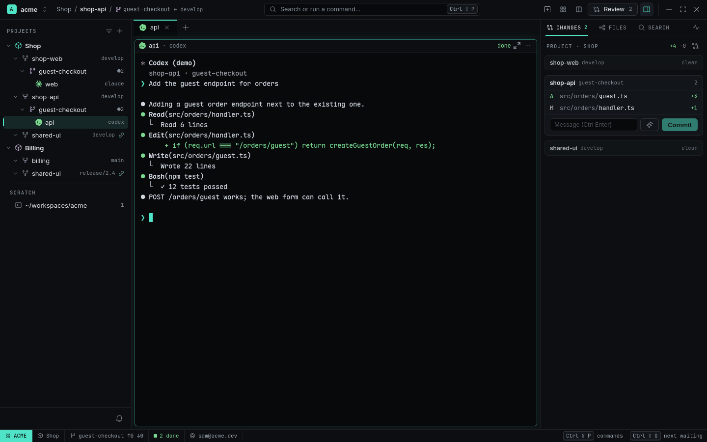

# One feature across two repositories

**The idea:** most features touch more than one repository — a form in the web app, an endpoint
in the API. A Project keeps them together: one Worktree in each, an Agent in each, one place to
see and commit all of it.

<picture>
  <source media="(prefers-color-scheme: light)" srcset="../images/crossrepo-light.png">
  
</picture>

## 1. The Project

Shop links `shop-web`, `shop-api` and `shared-ui`, each at `develop`:

```sh
rade project add Shop --source shop-web:develop --source shop-api:develop --source shared-ui:develop
```

## 2. One Worktree per repository

```sh
rade worktree add shop-web guest-checkout --project shop
rade worktree add shop-api guest-checkout --project shop
```

Both branches start from `develop` — Shop's base — not from `main`. In the Navigator each
appears under its own link.

## 3. An Agent in each

```sh
rade spawn --source shop-web --worktree guest-checkout --agent claude --name web "Build the guest checkout form"
rade spawn --source shop-api --worktree guest-checkout --agent codex  --name api "Add the guest endpoint for orders"
```

They work in parallel without touching each other's files. Tell one about the other, or let them
talk: the web Agent can `rade read api` to see the endpoint's shape.

## 4. Changes by Project

The Inspector's **Changes** shows Project Shop as one page: a group per link with its own files
and commit box, and the Project's total `+/−` at the top. Focus the `api` Agent and its Worktree's
group fills in:

<picture>
  <source media="(prefers-color-scheme: light)" srcset="../images/crossrepo-api-light.png">
  
</picture>

Review each Worktree (`Ctrl+Shift+R`), commit each, and open one PR per repository — each against
`develop`.

## Why it works

- The base is the Project's, so every Review and PR compares against the right branch.
- The same Worktree name in each repository keeps the feature recognizable everywhere.
- A repository used by two Projects at two bases gets a checkout per base, never a switched one.

## What you used

[Projects and Worktrees](../features/projects-and-worktrees.md) ·
[Changes and PRs](../features/changes-and-prs.md) ·
[Organizing Workspaces and Projects](../guides/organizing-workspaces-and-projects.md)
