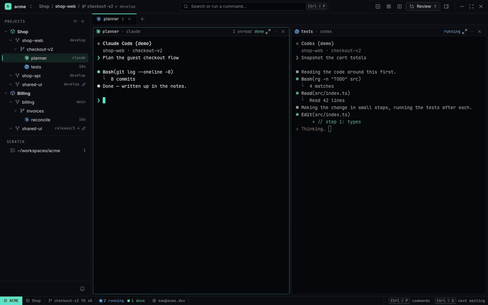
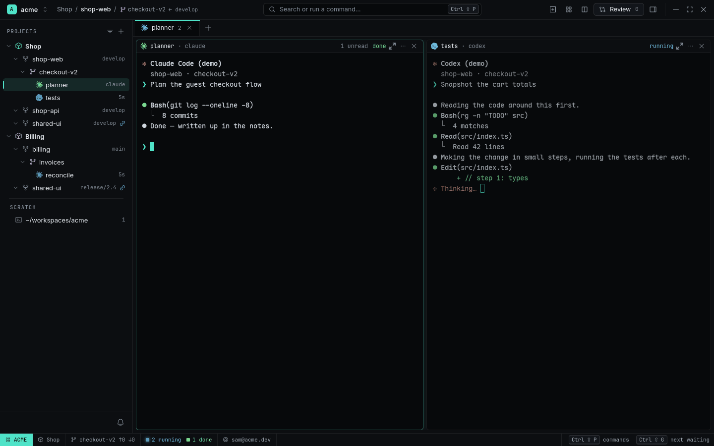
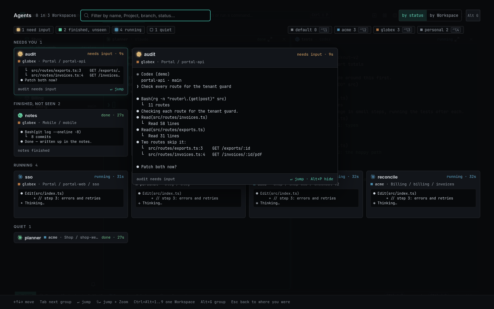
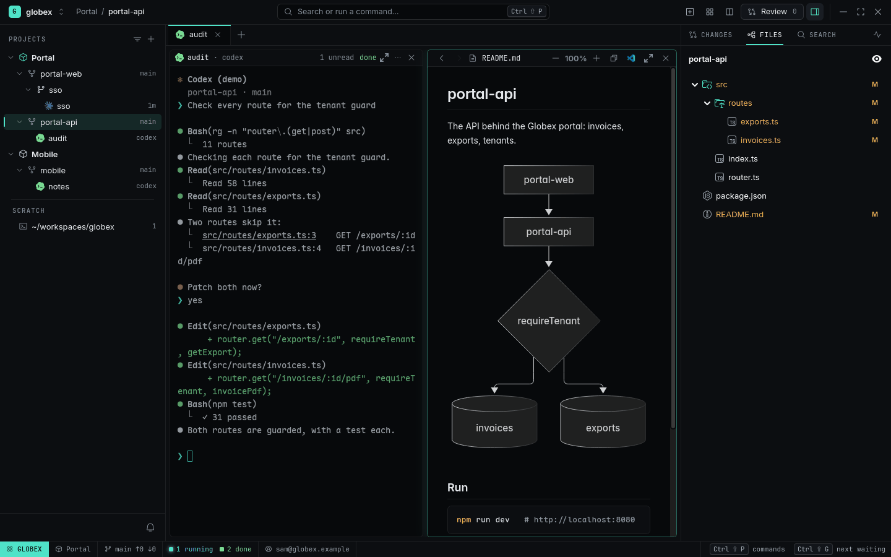

# Three Workspaces, one window

**The idea:** you work for Acme, contract for a client (Globex) and keep side projects — each
with several products, each product with Agents at work. One window holds all of it: you look at
one Workspace at a time, the others keep running, and nothing that needs you goes unnoticed.


<sub>[Watch as MP4](../images/tour.mp4) · [Narrated, on YouTube](https://www.youtube.com/watch?v=rpGTswqz1_U)</sub>

## The setup

| Workspace | Projects | Agents |
|---|---|---|
| `acme` (work) | **Shop** — shop-web, shop-api, shared-ui at `develop`; **Billing** — billing at `main`, shared-ui at `release/2.4` | `planner`, `tests` in Worktree `checkout-v2`; `reconcile` in `invoices` |
| `globex` (client) | **Portal** — portal-web, portal-api; **Mobile** — mobile | `sso` in Worktree `sso`, `notes`, and later `audit` |
| `personal` | **Blog**, **Dotfiles** | `post`, `nvim` |

```sh
rade workspace add ~/workspaces/globex
rade source add ~/workspaces/globex/portal-web --workspace globex
rade source add ~/workspaces/globex/portal-api --workspace globex
rade workspace switch globex
rade project add Portal --source portal-web:main --source portal-api:main
```

Each Workspace brings its own git email, `gh` login and agent accounts — see
[Two companies, one laptop](two-companies-one-laptop.md) for that part.

<picture>
  <source media="(prefers-color-scheme: light)" srcset="../images/tour-light.png">
  
</picture>

## 1. Switch, and keep going

`Ctrl+Alt+1…9` (or the Workspace button at the top left) shows another Workspace: its own
Navigator, Tabs and Statusline. Nothing stops in the one you leave.

## 2. Something needs you elsewhere

While you're in `acme`, Globex's `audit` Agent asks *"Patch both now?"*. A Toast names the
Workspace (`[globex] audit needs input`), the Workspace button and the switcher get an amber `!`,
and a desktop notification goes out if the window isn't in front.

## 3. Agent Overview

`Ctrl+Shift+Space`, from anywhere: every Agent of all three Workspaces, **Needs you** first. The
selected card gets a **Preview** — its live screen, large enough to read the question. Move with
`Ctrl+Shift+Space` again (or the arrows), `Alt+G` to group by Workspace, `Enter` to jump. RADE
switches to `globex` and focuses `audit`; you answer in its Pane.

<picture>
  <source media="(prefers-color-scheme: light)" srcset="../images/overview-preview-light.png">
  
</picture>

## 4. Read what it touched

`audit` printed `src/routes/exports.ts:3`: `Ctrl+click` it and the file opens in a Viewer beside
the Agent. `Ctrl+Shift+E` shows the Inspector; the **Files** tab has the Worktree's tree with the
changed files marked, and `README.md` opens rendered, Mermaid diagram included.

<picture>
  <source media="(prefers-color-scheme: light)" srcset="../images/files-viewer-light.png">
  
</picture>

## Tips

- One Workspace per identity, one Project per product, one Worktree per task — the
  [guide](../guides/organizing-workspaces-and-projects.md) explains why.
- `Ctrl+Shift+G` jumps to the newest Agent that needs you, in any Workspace.
- Quit and start again: every Workspace, Tab and Agent comes back (Session Restore).

## What you used

[Workspaces and identity](../features/workspaces-and-identity.md) ·
[Projects and Worktrees](../features/projects-and-worktrees.md) ·
[Agent Overview](../features/agent-overview.md) · [Viewer, files and search](../features/viewer-files-search.md)
